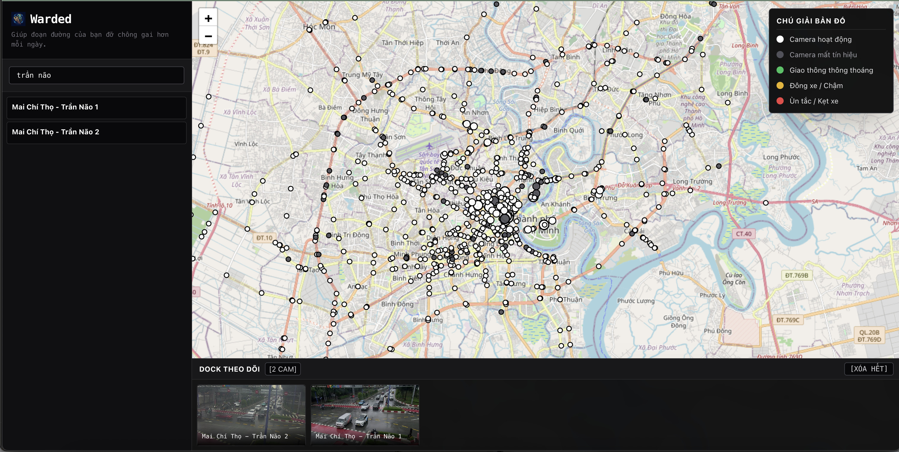
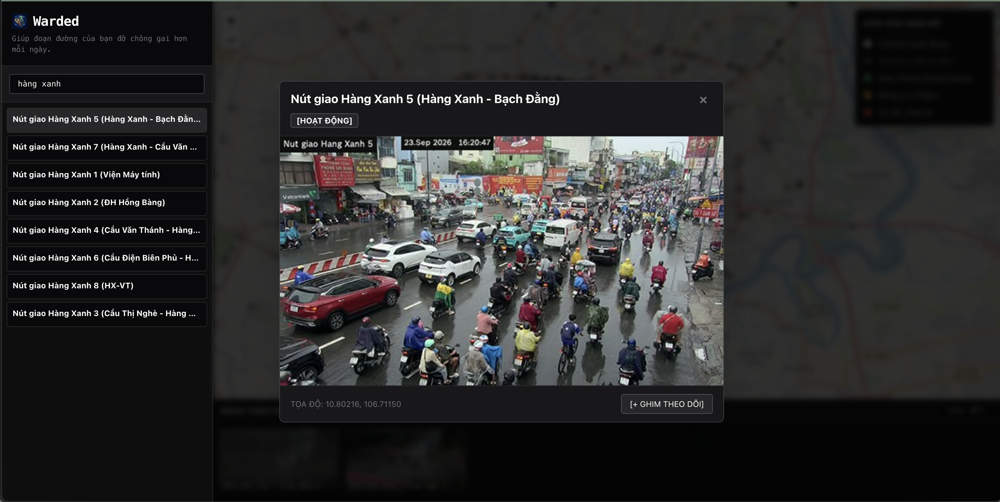

# CAMERA VIEW

<div align="center">

**Ho Chi Minh City Traffic Camera Monitor & Extensible Analytics**  
*Ứng Dụng Xem Camera Giao Thông TP. Hồ Chí Minh & Tính Năng Mở Rộng*

<p align="center">
  <a href="https://github.com/529-studio/projectKV/actions"></a>
  <a href="https://nextjs.org/"></a>
  <a href="https://www.typescriptlang.org/"></a>
  <a href="https://tailwindcss.com/"></a>
  <a href="https://www.framer.com/motion/"></a>
  <a href="https://leafletjs.com/"></a>
  <a href="https://go.dev/"></a>
  <a href="https://sqlite.org/"></a>
  <a href="docs/ADR-001-flood-alert-architecture.md#adr-003-sprint-1-scope--live-updates-sse-hot-set-scoped-congestion-colors-phường-based-filter"></a>
  <a href="https://open-meteo.com/"></a>
  <a href="https://www.rainviewer.com/api.html"></a>
  <a href="https://www.cloudflare.com/developer-platform/r2/"></a>
  <a href="https://python.org/"></a>
  <a href="LICENSE"></a>
</p>

[🇬🇧 English](#-english) &nbsp;•&nbsp; [🇻🇳 Tiếng Việt](#-tiếng-việt)

<br />
<br />

<p align="center">
  
</p>
<p align="center">
  <em>Multi-Camera Corridor Tracking Dock & Map Explorer</em>
</p>

<br />

<p align="center">
  
</p>
<p align="center">
  <em>Live Camera Snapshot Modal with Traffic Verdict & Pin Control</em>
</p>

</div>

---

# 🇬🇧 English

> **Ho Chi Minh City traffic camera viewer and explorer optimized for low latency, clean monochromatic high-contrast UI, chained hierarchical filtering, multi-camera pin dock, and extensible modular architecture — extending toward real-time computer vision and flood alerting.**

The system is organized as a **clean monorepo**, decoupling the Web Client (`apps/web`) from a Go backend (`services/go-server`), with a separate Python service (`services/cv-engine`) for model inference. See [`docs/ADR-001-flood-alert-architecture.md`](docs/ADR-001-flood-alert-architecture.md) for the full architectural rationale.

## 1. Project Directory Structure (Monorepo)

```
hcm-traffic-cameras/
│
├── apps/
│   └── web/                           # [FRONTEND] Next.js App Router Client (@camera-view/web)
│       ├── src/
│       │   ├── app/                   # App Router pages & layout
│       │   ├── components/            # Leaflet map, docked tracking UI, modals, legends
│       │   ├── hooks/                 # useCameras, useTraffic (SSE EventSource)
│       │   └── config/                # API endpoints, map constants
│       ├── tailwind.config.ts         # Tailwind CSS styling
│       └── package.json
│
├── services/
│   ├── go-server/                     # [BACKEND — Go] Single static binary (Gin + SQLite + R2 Storage)
│   │   ├── cmd/
│   │   │   ├── server/main.go         # Composition root, routing, graceful shutdown
│   │   │   ├── sync-proofs/main.go    # High-concurrency Cloudflare R2 proofs sync CLI
│   │   │   └── verify-r2/main.go      # Cloudflare R2 connectivity verification tool
│   │   └── internal/
│   │       ├── live/                  # Server-Sent Events (SSE) hub & live stream endpoint
│   │       ├── camera/                # Camera catalog, Phường indexing, query endpoints
│   │       ├── proxycache/            # Snapshot reverse-proxy + in-memory TTL cache
│   │       ├── hotset/                # Hot Set Pool scheduler (see ADR-001 §2)
│   │       ├── storage/               # Pluggable object storage (LocalStorage & Cloudflare R2)
│   │       ├── archiver/              # Snapshot proof archiver with ICT (UTC+7) timezone standard
│   │       ├── harvester/             # Autonomous dual-trigger poller, label generator & R2 streamer
│   │       ├── notify/                # Notification Adapter: Telegram / Zalo / WebPush / SMS
│   │       ├── store/                 # SQLite (pure Go, no cgo) — subscriptions, dedupe, verdicts
│   │       └── tilecache/             # Offline/local map tile proxy and caching
│   │
│   └── cv-engine/                     # [ML PLANE — Python] Model inference on dev-box worker
│       ├── models/                    # YOLO / ONNX / OpenVINO IR FP16 weights
│       └── api.py                     # Multi-threaded OpenVINO detection endpoint (:8000)
│
├── tools/
│   ├── eval/                          # [EVALUATION] Ground-truth benchmarks & label curation
│   │   ├── auto_harvest.py            # Standalone automated frame harvester & Draft-07 labeler CLI
│   │   ├── label_curator.py           # Taxonomy curation and legacy label cleansing
│   │   └── benchmark.py               # PCU & flood accuracy evaluation harness
│   ├── storage/                       # [OBJECT STORAGE] Cloudflare R2 verification tooling
│   │   └── verify_r2.py               # Boto3 / R2 connectivity verification script
│   ├── geo-enrich/                    # [GEO ENRICHMENT] Batch Phường point-in-polygon tool
│   │   ├── enrich.py                  # CLI enrichment script (Ray casting / Shapely)
│   │   └── data/                      # GeoJSON boundary polygons
│   └── crawler/                       # [DATA CRAWLER]
│       └── get_all_cameras.js         # Fetch camera dataset from official DOT portal
│
├── docs/
│   ├── SYSTEM_DESIGN.md               # Original caching & CV roadmap design
│   ├── ADR-001-flood-alert-architecture.md   # Flood-alert feasibility, Go migration & Sprint 1 scope
│   └── sprint1_execution_guide.md     # Sprint 1 task sequencing and agy CLI commands
│
├── cameras_all.json                   # Base traffic camera catalog dataset
├── cameras_enriched.json              # Enriched camera catalog with phuong_id / phuong_name
├── Makefile                           # Unified orchestration commands
├── LICENSE                            # Strict proprietary, reference-only license
└── README.md                          # Project documentation
```

> **Migration note**: `services/node-server` (the original Express.js proxy) is being retired in favor of `services/go-server`. The migration is incremental — new components (Hot Set Scheduler, Notification Adapter, SQLite state store) are Go-native from the start; the existing snapshot proxy/cache is ported once the new components are verified stable. See ADR-002 for the full rationale.

## 2. Quick Start

### 2.1. Basic Mode (UI & Backend without Local Model Inference)
Suitable for rapid UI development, offline testing, or lightweight exploration:

```bash
# Install dependencies (Go modules + frontend, first time only)
make install

# Launch Go backend (:3000) and Next.js frontend dev server (:3001) concurrently
make dev-all

# Or run the Go backend only (Port 3000) - Serves both API and Web Frontend
make dev-go

# (Optional) Run standalone static server for Frontend (Port 3001)
make dev-web

# Crawl & update camera dataset from official DOT portal
make crawl
```

### 2.2. Full-Stack with Local OpenVINO Model Inference (Recommended)
To run real AI vehicle detection and PCU saturation scoring locally using self-hosted OpenVINO (`yolov8n_openvino_320`):

```bash
# Step 1: Start the CV Engine container in the background (port 8000)
make dev-model
# (Equivalent to: docker compose -f docker-compose.local.yml up -d)

# Step 2: Ensure .env is configured for local OpenVINO inference:
# ANALYZER=onnx
# CV_ENGINE_URL=http://localhost:8000

# Step 3: Launch Go Backend (:3000) and Next.js Frontend (:3001)
make dev-all
```

#### Service Endpoints & Verification Matrix

| Service | Port | Endpoint URL | Verification Check |
|---|:---:|---|---|
| **Web Map Explorer** | `3001` | http://localhost:3001 | Interactive Leaflet map, corridor dock |
| **Collaborative Labeler** | `3001` | http://localhost:3001/labeler | Snapshot labeling tool with auto-harvest review filters, in-memory partition cache, and Shift+Enter fast approval |
| **Go Backend API** | `3000` | http://localhost:3000 | Core Gin HTTP REST server |
| **Subscription API** | `3000` | http://localhost:3000/api/subscriptions | `POST`, `GET`, `DELETE` flood alert subscriptions |
| **Swagger UI** | `3000` | http://localhost:3000/swagger/index.html | Interactive OpenAPI documentation |
| **Backend Health** | `3000` | http://localhost:3000/health | Returns `{"status":"ok"}` |
| **CV Inference Engine** | `8000` | http://localhost:8000/healthz | Returns `{"status":"healthy","model":"yolov8n_openvino_320"}` |

> [!NOTE]
> `make dev-all` launches the Go backend and Next.js dev server. It expects the `warded-model` Docker container to be already running if `ANALYZER=onnx` is configured.

*   **Browser Access**:
    *   Full Application (Backend + Web): `http://localhost:3000`
    *   Standalone Frontend Dev: `http://localhost:3001`

## 3. Key Highlights

*   **Monochromatic & Intuitive Interface**: Minimalist high-contrast design using black, dark gray, and white tones.
*   **Bilingual i18n Support**: Instant switching between Vietnamese (`vi`, default) and English (`en`), persisted across sessions.
*   **Clean Standard OSM Basemap**: OpenStreetMap tiles, no watermark, geographically constrained to Southeastern Vietnam (`maxBounds`).
*   **Map Clutter Hygiene & Offline Camera Filtering**: Automatically hides 135 offline or no-signal cameras (`status === 'NOT_IMAGE'` / `'NO_SIGNAL'`) by default, with dynamic header counter badge (`Đang hiển thị 702 / 837 camera`) and a monochromatic toggle button.
*   **Chained Deep Filter**: Multi-tier faceted filtering — *Zone* ➔ *Road / Corridor* ➔ *Intersection / Node*.
*   **Real-Time Arterial Marker Saturation Coloring**: Dynamically styles the 50 arterial Hot Set camera markers based on continuous 30-second autonomous ONNX PCU saturation indexes: Emerald green (`#10b981`) for Clear ($SI < 0.30$), Amber yellow (`#f59e0b`) for Moderate ($0.30 \le SI < 0.60$), and Rose red (`#ef4444`) for Congested ($SI \ge 0.60$) with subtle pulsating CSS animation, rich tooltip metrics (SI% & PCU), and monochromatic map footer legend `[Xanh: Thông thoáng] [Vàng: Đông xe] [Đỏ: Ùn ứ]`.
*   **Calibrated Doppler Rain Radar Pipeline (S8-T1)**: RainViewer Doppler radar tiles projected at raw Zoom 8 (`0_0.png`) with true meteorological RGB reflectivity (dBZ) decoding ($18–29\text{ dBZ}$ Light, $30–39\text{ dBZ}$ Moderate, $\ge 40\text{ dBZ}$ Heavy rain), 7-point hexagon spatial contraction sampling with quorum, and surface cross-validation gate with ground cameras, preventing false inundation alarms on clear days.
*   **Multi-Camera Corridor Tracking Dock**: Pin cameras into the bottom tracking dock with synchronized snapshot refresh.
*   **Human-in-the-Loop Flood Reporting & Real-Time Map Bridge (S8-T7)**: Commuters can report real-time street flooding directly from the camera modal with sliding rate limits; reports bridge live to SSE map streams and spatial hex aggregators, highlighting cameras with high-contrast amber markers (`[Báo cáo từ người dân: Có ngập]`), 15-minute sliding TTL, and multi-reporter escalation ($\ge 2$ distinct IP hashes within 10 minutes).
*   **Directional Multi-Lane Taxonomy & Physical Flood Markers**: Classifies traffic density independently by direction (Direction A approaching vs Direction B receding) to resolve asymmetric divided boulevards, and anchors flood severity strictly to physical tire/wheel depth markers.
*   **Responsive Layout (100dvh)**: Desktop, tablet, and smartphone friendly with collapsible legend and mobile bottom-sheet drawer.
*   **Go Backend**: Single static binary, no runtime dependency install, in-memory + SQLite state, goroutine-based Hot Set scheduler.
*   **Cloudflare R2 Object Storage**: S3-compatible cloud storage (`warded-proofs`) for snapshot proofs, distributed via edge CDN (`https://file.529studio.site`) for centralized team labeling workflows.

### Microservice Architecture & Host Topology

| Service | Technology | Port | Host & Node Role | Primary Responsibilities |
|---|---|:---:|---|---|
| **Web Client** (`apps/web`) | Next.js 15, React 19, Tailwind CSS, Leaflet | `3001` | `homesrv` (Portainer Endpoint 3) | Map visualization, discrete camera marker dots, H3 hex overlays, horizontal corridor dock, bilingual UI (`vi` / `en`). |
| **Backend API** (`services/go-server`) | Go 1.26, Gin, SQLite (WAL mode) | `3000` | `homesrv` (Portainer Endpoint 3) | Snapshot proxy cache (15s TTL), camera catalog, hotset scheduler (30s cycle), crowdsourced flood report archiver (`internal/feedback`), PCU Saturation Index, SSE stream, Cloudflare R2 storage integration. |
| **CV Engine** (`services/cv-engine`) | Python 3.11, ThreadingHTTPServer, OpenVINO IR, YOLOv8n FP16 | `8000` | `dev-box` (Portainer Endpoint 4) | High-throughput vehicle detection (`POST /predict`), class counting (motorcycle, car, bus, truck), `GET /healthz` healthchecks (24 FPS, ~18.2ms latency). |
| **Storage & Edge CDN** | Cloudflare R2, AWS Signature V4 | `443` | Cloudflare Edge (`file.529studio.site`) | S3-compatible snapshot proof repository (`warded-proofs`), Vietnam ICT (`UTC+7`) key hierarchy (`YYYY-MM-DD/<camera_id>/<unix_ts>_<reason>.jpg`). |

### Tech Stack & Core Libraries

| Layer | Technologies & Badges | Purpose |
|---|---|---|
| **Frontend** | [](https://nextjs.org/) [](https://www.typescriptlang.org/) [](https://tailwindcss.com/) [](https://www.framer.com/motion/) [](https://leafletjs.com/) | Next.js App Router, TypeScript, Tailwind CSS, Framer Motion animations, Leaflet interactive mapping |
| **Backend** | [](https://go.dev/) [](https://gin-gonic.com/) [](https://sqlite.org/) [](docs/ADR-001-flood-alert-architecture.md#adr-003-sprint-1-scope--live-updates-sse-hot-set-scoped-congestion-colors-phường-based-filter) | Single static binary, Gin HTTP router, SQLite state persistence, in-memory TTL proxy caching, Server-Sent Events (SSE) live streaming |
| **Cloud Storage & CDN** | [](https://www.cloudflare.com/developer-platform/r2/) [](https://github.com/aws/aws-sdk-go-v2) | Cloudflare R2 S3-compatible object storage (`warded-proofs`), public edge delivery (`file.529studio.site`), centralized proof snapshots repository |
| **Computer Vision** | [](https://python.org/) [](https://pytorch.org/) [](https://opencv.org/) [](https://openvino.ai/) | Python 3.11+, OpenVINO IR YOLOv8n FP16 inference, pluggable traffic congestion and flood alert analyzers |
| **Weather & Radar APIs** | [](https://open-meteo.com/) [](https://www.rainviewer.com/api.html) | Real-time weather, temperature, humidity, rainfall metrics (Open-Meteo) and live composite weather radar precipitation tiles (RainViewer) |
| **DevOps & Tooling** | [](https://github.com/features/actions) [](LICENSE) [](tools/geo-enrich) | GitHub Actions CI/CD workflows, golangci-lint, ESLint, unified Makefile, batch Phường point-in-polygon enrichment |

### Configuration Reference

#### Backend Service (`services/go-server`)

| Variable | Default Value | Description |
|---|---|---|
| `PORT` | `3000` | HTTP service port |
| `STORAGE_DRIVER` | `local` | Storage driver (`local` for disk or `r2` / `s3` for Cloudflare R2) |
| `STORAGE_LOCAL_ROOT` | `./data/proofs` | Root directory for local snapshot archiving |
| `R2_ACCOUNT_ID` | `bb67574163a065e4aad475fb3aa6bb92` | Cloudflare Account Identifier |
| `R2_ENDPOINT` | `https://<account_id>.r2.cloudflarestorage.com` | Base S3 API endpoint for Cloudflare R2 |
| `R2_BUCKET_NAME` | `warded-proofs` | Object storage bucket name |
| `R2_REGION` | `auto` | R2 signing region |
| `R2_PUBLIC_URL` | `https://file.529studio.site` | Cloudflare Edge CDN custom domain |
| `CV_ENGINE_URL` | `http://localhost:8000` | URL of self-hosted CV inference worker |
| `ANALYZER` | `none` | Traffic analyzer (`none`, `mock`, `vlm`, `onnx`) |
| `SNAPSHOT_UPSTREAM_BASE_URL` | *(required)* | DOT upstream image snapshot endpoint |
| `TELEGRAM_BOT_TOKEN` | `""` | Telegram Bot API token for flood warning dispatch (empty for simulation mode) |
| `TELEGRAM_DEBOUNCE_MINUTES` | `30` | Anti-spam quiet period debounce window per chokepoint (in minutes) |
| `HARVESTER_ENABLED` | `false` | Enable background dual-trigger scheduled & rain harvester |
| `HARVESTER_SCHEDULE_HOURS` | `7,12,17` | Daily peak harvest schedule in ICT (UTC+7, e.g. `07:30,12:00,17:30`) |
| `HARVESTER_RAIN_COOLDOWN_MINUTES` | `60` | Sliding window cooldown for rain watcher triggers (in minutes) |
| `HARVESTER_CONCURRENCY` | `15` | Worker pool concurrency for frame ingestion & R2 streaming |

#### CV Model Service (`services/cv-engine`)

| Parameter | Configuration | Description |
|---|---|---|
| **Host Worker** | `dev-box` (Portainer Endpoint 4) | Dedicated multi-core host with Tailscale mesh networking |
| **Model Runtime** | Intel OpenVINO 2024.4 IR | Optimized FP16 vehicle detection engine (~6.3 MB) |
| **Input Resolution** | 416x416 (with letterbox preprocessing & NMS) | Low-latency inference geometry with aspect ratio preservation and box deduplication |
| **Resource Caps** | 2 vCPU / 2 GB RAM | Resource limits configured via Docker Compose stack |
| **API Endpoints** | `POST /predict`, `GET /healthz` | Prediction endpoint accepting JPEG bytes and returning vehicle counts |


## 4. Next Evolution Steps

Detailed architectural decisions are documented in:
📄 **[`docs/SYSTEM_DESIGN.md`](docs/SYSTEM_DESIGN.md)** — original caching & CV roadmap
📄 **[`docs/ADR-001-flood-alert-architecture.md`](docs/ADR-001-flood-alert-architecture.md)** — flood-alert feasibility, notification channels, and the Go backend migration decision (ADR-002)
📄 **[`docs/ADR-009-zero-vlm-flood-segmentation.md`](docs/ADR-009-zero-vlm-flood-segmentation.md)** — self-hosted flood segmentation, OpenVINO model selection benchmarks, and dual-layer physical triangulation (Zero-VLM)

*   **Computer Vision Integration**: Traffic congestion + flood detection via a **Pluggable Adapter** pattern (Mock ➔ Cloud Vision API ➔ Self-hosted YOLO/ONNX), orchestrated from Go, model inference in Python.
*   **Real-Time Flood Alerting**: Zone-based subscriptions with a pluggable **Notification Adapter** — Telegram (Phase 1), Zalo OA (Phase 2), Web Push, SMS — because a rider on a motorbike cannot open a browser tab to check a map.

---

# 🇻🇳 Tiếng Việt

> **Ứng dụng tra cứu và theo dõi camera giao thông Thành phố Hồ Chí Minh với độ trễ thấp tối ưu, giao diện tối giản trực quan, hỗ trợ bộ lọc phân cấp liên hoàn, dock ghim theo dõi nhiều camera đồng thời, tích hợp đa ngôn ngữ i18n cùng các tính năng phân tích mở rộng — hướng tới xử lý thị giác máy tính thời gian thực và cảnh báo ngập lụt.**

Hệ thống được tổ chức theo mô hình monorepo, tách biệt Web Client (`apps/web`) khỏi backend Go (`services/go-server`), với một service Python riêng (`services/cv-engine`) chuyên trách suy luận mô hình (model inference).

## Điểm nổi bật chính

*   **Giao diện tối giản & Trực quan**: Thiết kế đơn sắc tương phản cao với gam màu đen, xám và trắng.
*   **Hỗ trợ đa ngôn ngữ i18n**: Chuyển đổi tức thì giữa Tiếng Việt (`vi`, mặc định) và Tiếng Anh (`en`), tự động ghi nhớ tùy chọn.
*   **Tối ưu trực quan bản đồ & Lọc camera mất tín hiệu**: Mặc định ẩn 135 camera mất tín hiệu hoặc lỗi nguồn (`NOT_IMAGE` / `NO_SIGNAL`), hiển thị huy hiệu đếm camera trực quan (`Đang hiển thị 702 / 837 camera`) kèm nút chuyển đổi tinh tế.
*   **Bộ lọc sâu liên hoàn (Chained Filter)**: Lọc đa tầng theo *Phường / Khu vực* ➔ *Tuyến đường / Hành lang* ➔ *Giao lộ*.
*   **Màu sắc Điểm nghẽn Trục chính Thời gian thực**: Tự động tô màu 50 camera Hot Set trục chính theo chu kỳ 30 giây dựa trên chỉ số bão hòa PCU từ OpenVINO: Xanh lục (`#10b981`) khi Thông thoáng ($SI < 0.30$), Vàng hổ phách (`#f59e0b`) khi Đông xe ($0.30 \le SI < 0.60$), và Đỏ hồng (`#ef4444`) khi Ùn ứ ($SI \ge 0.60$) với hiệu ứng xung nhịp tinh tế, tooltip hiển thị phần trăm bão hòa và PCU, cùng thanh chú giải đơn sắc ở chân bản đồ `[Xanh: Thông thoáng] [Vàng: Đông xe] [Đỏ: Ùn ứ]`.
*   **Đại tu Đường ống Radar Doppler Khí tượng (S8-T1)**: Chiếu tile radar RainViewer ở độ phân giải gốc Zoom 8 (`0_0.png`) không nội suy mờ nhòe, giải mã phản hồi RGB theo ngưỡng phản xạ thực tế dBZ (18–29 dBZ Mưa nhỏ, 30–39 dBZ Mưa vừa, $\ge 40$ dBZ Mưa to), lấy mẫu 7 điểm co rút hình học với cơ chế đồng thuận quorum $\ge 3/7$, kết hợp cổng đối soát thực địa với camera mặt đường giúp triệt tiêu hoàn toàn cảnh báo ngập giả vào ngày nắng ráo.
*   **Dock theo dõi nhiều camera đồng thời**: Ghim tối đa 12 camera quan trọng vào thanh dock bên dưới với chu kỳ tự động cập nhật snapshot đồng bộ.
*   **Báo cáo ngập nước cộng đồng (Human-in-the-Loop)**: Cho phép người dân báo cáo ngập thực địa ngay trong modal camera kèm bộ đếm ngược chống spam 30 giây và phản hồi xúc giác tối giản.
*   **Phân loại đa làn hai chiều & Mốc ngập thực tế**: Phân loại mật độ giao thông độc lập theo hướng (Hướng A xe tiến vs Hướng B xe lùi) xử lý bất đối xứng trên đại lộ phân cách, đồng thời neo mức độ ngập lụt chuẩn hóa theo vạch vành bánh xe máy.
*   **Backend Go hiệu năng cao**: File thực thi tĩnh duy nhất, lưu trữ SQLite WAL, điều phối Hot Set theo chu kỳ 30s.
*   **Lưu trữ Cloudflare R2**: Lưu trữ ảnh snapshot bằng chứng giao thông chuẩn hóa thời gian ICT (UTC+7), phân phối qua Edge CDN (`https://file.529studio.site`).

## Khởi chạy nhanh

### Cách 1: Khởi chạy cơ bản (Không cần Docker model)
Phù hợp để phát triển giao diện hoặc kiểm thử nhanh mà không cần chạy mô hình nhận diện AI:

```bash
# Cài đặt dependencies (lần đầu tiên)
make install

# Khởi chạy Go Backend (:3000) và Next.js Frontend (:3001) đồng thời
make dev-all

# Hoặc chỉ chạy Go Backend (cổng 3000) - Phục vụ cả API và Web tĩnh
make dev-go
```

### Cách 2: Khởi chạy Full-Stack kèm Mô hình OpenVINO cục bộ (Khuyên dùng)
Để chạy toàn bộ hệ thống thực tế với mô hình YOLOv8n OpenVINO nhận diện xe và tính toán chỉ số bão hòa PCU:

```bash
# Bước 1: Khởi động container model ngầm (cổng 8000)
make dev-model
# (Tương đương: docker compose -f docker-compose.local.yml up -d)

# Bước 2: Đảm bảo file .env đã cấu hình kết nối model:
# ANALYZER=onnx
# CV_ENGINE_URL=http://localhost:8000

# Bước 3: Chạy song song Go Backend (:3000) và Next.js Frontend (:3001)
make dev-all
```

#### Bảng Cổng Dịch Vụ & Địa Chỉ Truy Cập Cục Bộ

| Dịch vụ | Cổng | Địa chỉ truy cập | Mục đích kiểm tra |
|---|:---:|---|---|
| **Giao diện Bản đồ** | `3001` | http://localhost:3001 | Bản đồ camera, dock theo dõi hành lang |
| **Gán nhãn Labeler** | `3001` | http://localhost:3001/labeler | Công cụ dán nhãn tập trung với bộ lọc duyệt nhãn tự động, bộ nhớ đệm phân vùng và phím tắt duyệt nhanh Shift+Enter |
| **Go Backend API** | `3000` | http://localhost:3000 | Máy chủ API Gin |
| **API Đăng ký Cảnh báo** | `3000` | http://localhost:3000/api/subscriptions | `POST`, `GET`, `DELETE` đăng ký cảnh báo ngập |
| **Tài liệu Swagger** | `3000` | http://localhost:3000/swagger/index.html | Tài liệu API tương tác |
| **Kiểm tra Sức khỏe BE** | `3000` | http://localhost:3000/health | Phản hồi `{"status":"ok"}` |
| **Mô hình CV Engine** | `8000` | http://localhost:8000/healthz | Phản hồi trạng thái container `warded-model` |

> [!NOTE]
> `make dev-all` khởi chạy Go Backend và Next.js Dev Server. Lệnh này giả định container Docker `warded-model` đã được khởi động từ trước khi chọn `ANALYZER=onnx`.

*   **Truy cập trình duyệt**:
    *   Toàn bộ ứng dụng (Backend + Web tĩnh): `http://localhost:3000`
    *   Giao diện Frontend Dev (Hot Reload): `http://localhost:3001`

## Hạ tầng & Phân bổ Microservices

| Dịch vụ | Công nghệ | Cổng | Node & Máy chủ | Vai trò chính |
|---|---|:---:|---|---|
| **Web Client** (`apps/web`) | Next.js 15, React 19, Tailwind CSS, Leaflet | `3001` | `homesrv` (Portainer Endpoint 3) | Trực quan hóa bản đồ, điểm tròn camera, H3 hex overlay, dock ghim camera, giao diện song ngữ (`vi` / `en`). |
| **Backend API** (`services/go-server`) | Go 1.26, Gin, SQLite (WAL mode) | `3000` | `homesrv` (Portainer Endpoint 3) | Proxy cache snapshot (15s TTL), điều phối Hot Set (chu kỳ 30s), lưu trữ và cầu nối phản ánh ngập cộng đồng thời gian thực (`internal/feedback` sang SSE & Hex Aggregator), tính chỉ số bão hòa PCU, luồng SSE, tích hợp lưu trữ Cloudflare R2. |
| **CV Engine** (`services/cv-engine`) | Python 3.11, ThreadingHTTPServer, OpenVINO IR, YOLOv8n FP16 | `8000` | `dev-box` (Portainer Endpoint 4) | Nhận diện phương tiện thông lượng cao (`POST /predict`), phân loại đếm xe, kiểm tra sức khỏe `GET /healthz` (24 FPS, ~18.2ms latency). |
| **Lưu trữ & Edge CDN** | Cloudflare R2, AWS Signature V4 | `443` | Cloudflare Edge (`file.529studio.site`) | Lưu trữ ảnh chụp bằng chứng giao thông (`warded-proofs`), phân cấp ngày theo giờ Việt Nam ICT (`UTC+7`, `YYYY-MM-DD/<camera_id>/<unix_ts>_<reason>.jpg`). |

## Công nghệ cốt lõi (Tech Stack)

| Phân tầng | Công nghệ & Huy hiệu | Vai trò |
|---|---|---|
| **Frontend** | [](https://nextjs.org/) [](https://www.typescriptlang.org/) [](https://tailwindcss.com/) [](https://www.framer.com/motion/) [](https://leafletjs.com/) | Next.js App Router, TypeScript, Tailwind CSS, animation Framer Motion, bản đồ tương tác Leaflet |
| **Backend** | [](https://go.dev/) [](https://gin-gonic.com/) [](https://sqlite.org/) [](docs/ADR-001-flood-alert-architecture.md#adr-003-sprint-1-scope--live-updates-sse-hot-set-scoped-congestion-colors-phường-based-filter) | Single static binary (Go), Gin router, lưu trữ SQLite, in-memory TTL cache, phát luồng Server-Sent Events (SSE) trực tiếp |
| **Lưu trữ đám mây & CDN** | [](https://www.cloudflare.com/developer-platform/r2/) [](https://github.com/aws/aws-sdk-go-v2) | Lưu trữ ảnh bằng chứng trên Cloudflare R2 (`warded-proofs`), phân phối qua Edge CDN (`file.529studio.site`), phục vụ dán nhãn tập trung cho toàn đội ngũ |
| **Thị giác máy tính** | [](https://python.org/) [](https://pytorch.org/) [](https://opencv.org/) [](https://openvino.ai/) | Python 3.11+, suy luận mô hình OpenVINO IR YOLOv8n FP16, phân tích kẹt xe và ngập úng |
| **Dịch vụ Thời tiết & Radar** | [](https://open-meteo.com/) [](https://www.rainviewer.com/api.html) | Dữ liệu khí tượng, nhiệt độ, lượng mưa thời gian thực (Open-Meteo) và tile ảnh radar phản hồi mưa trực tiếp (RainViewer) |
| **DevOps & Công cụ** | [](https://github.com/features/actions) [](LICENSE) [](tools/geo-enrich) | CI/CD GitHub Actions, golangci-lint, ESLint, Makefile điều phối tập trung, công cụ gán Phường point-in-polygon |

### Bảng Thông Số Cấu Hình Dịch Vụ

#### Dịch vụ Backend (`services/go-server`)

| Biến môi trường | Giá trị mặc định | Diễn giải |
|---|---|---|
| `PORT` | `3000` | Cổng dịch vụ HTTP |
| `STORAGE_DRIVER` | `local` | Trình điều khiển lưu trữ (`local` cho ổ cứng máy chủ hoặc `r2` / `s3` cho Cloudflare R2) |
| `STORAGE_LOCAL_ROOT` | `./data/proofs` | Thư mục lưu trữ bằng chứng cục bộ khi dùng driver `local` |
| `R2_ACCOUNT_ID` | `<your-cloudflare-account-id>` | Định danh tài khoản Cloudflare |
| `R2_ENDPOINT` | `https://<account_id>.r2.cloudflarestorage.com` | Base endpoint chuẩn S3 REST API cho Cloudflare R2 |
| `R2_BUCKET_NAME` | `warded-proofs` | Tên bucket lưu trữ đối tượng ảnh |
| `R2_REGION` | `auto` | Vùng ký xác thực AWS Signature V4 của R2 |
| `R2_PUBLIC_URL` | `https://file.529studio.site` | Tên miền phân phối tĩnh Cloudflare Edge CDN |
| `CV_ENGINE_URL` | `http://localhost:8000` | Địa chỉ mạng kết nối tới máy chủ suy luận mô hình CV |
| `ANALYZER` | `none` | Trình phân tích giao thông (`none`, `mock`, `vlm`, `onnx`) |
| `SNAPSHOT_UPSTREAM_BASE_URL` | *(bắt buộc)* | Cổng snapshot camera giao thông Sở GTVT TP.HCM |
| `TELEGRAM_BOT_TOKEN` | `""` | Token Telegram Bot API để phát cảnh báo ngập lụt (để trống để chạy ở chế độ giả lập) |
| `TELEGRAM_DEBOUNCE_MINUTES` | `30` | Cửa sổ trượt chống spam cảnh báo cho từng điểm ngập (phút) |
| `HARVESTER_ENABLED` | `false` | Bật module chạy nền tự động thu thập ảnh theo lịch và theo mưa |
| `HARVESTER_SCHEDULE_HOURS` | `7,12,17` | Lịch thu thập khung giờ cao điểm theo giờ Việt Nam ICT (UTC+7, ví dụ `07:30,12:00,17:30`) |
| `HARVESTER_RAIN_COOLDOWN_MINUTES` | `60` | Cửa sổ trượt giãn cách giữa các lần kích hoạt thu thập theo mưa (phút) |
| `HARVESTER_CONCURRENCY` | `15` | Số lượng luồng worker thu thập ảnh và đẩy lên R2 đồng thời |

#### Dịch vụ Suy Luận Mô Hình (`services/cv-engine`)

| Thông số | Giá trị triển khai | Diễn giải |
|---|---|---|
| **Máy chủ Host** | `dev-box` (Portainer Endpoint 4) | Máy chủ phần cứng độc lập, kết nối mạng nội bộ an toàn qua Tailscale mesh |
| **Engine thực thi** | Intel OpenVINO 2024.4 IR | Runtime tối ưu hóa FP16 suy luận trên CPU cho kiến trúc YOLOv8n (~6.3 MB) |
| **Kích thước ảnh** | 416x416 (kèm tiền xử lý letterbox & NMS) | Cân bằng giữa bảo toàn tỷ lệ khung hình, chống trùng lặp hộp nhận diện và độ trễ thấp |
| **Giới hạn tài nguyên** | 2 vCPU / 2 GB RAM | Mức trần tài nguyên cấu hình qua Docker Compose stack |
| **Endpoint API** | `POST /predict`, `GET /healthz` | Nhận ảnh JPEG nhị phân, phản hồi danh sách xe đếm được và nhịp tim sức khỏe |

## Tài liệu kiến trúc chuyên sâu
- [`docs/SYSTEM_DESIGN.md`](docs/SYSTEM_DESIGN.md) — thiết kế caching & roadmap CV gốc.
- [`docs/ADR-001-flood-alert-architecture.md`](docs/ADR-001-flood-alert-architecture.md) — đánh giá khả thi cảnh báo ngập lụt, lựa chọn kênh thông báo (Telegram/Zalo/Web Push/SMS), và quyết định chuyển backend sang Go (ADR-002).
- [`docs/ADR-009-zero-vlm-flood-segmentation.md`](docs/ADR-009-zero-vlm-flood-segmentation.md) — đặc tả kỹ thuật phân đoạn ảnh ngập nước on-premise, benchmark OpenVINO và phân tầng vật lý 2 lớp (Zero-VLM).

## Vì sao chuyển sang Go?
Không phải vì lưu lượng hiện tại đã vượt ngưỡng (chưa vượt), mà vì các thành phần mới cần xây (Hot Set Scheduler, Notification Adapter, state store, R2 object storage) hợp với goroutine/channel hơn, và rủi ro viết mới bằng Go thấp hơn nhiều so với việc viết lại `server.js` đang chạy ổn. Phần suy luận mô hình CV (YOLO/ONNX/OpenVINO, xử lý ảnh nặng) được đưa lên node phần cứng `dev-box` riêng biệt để bảo toàn CPU cho máy chủ web và backend.

