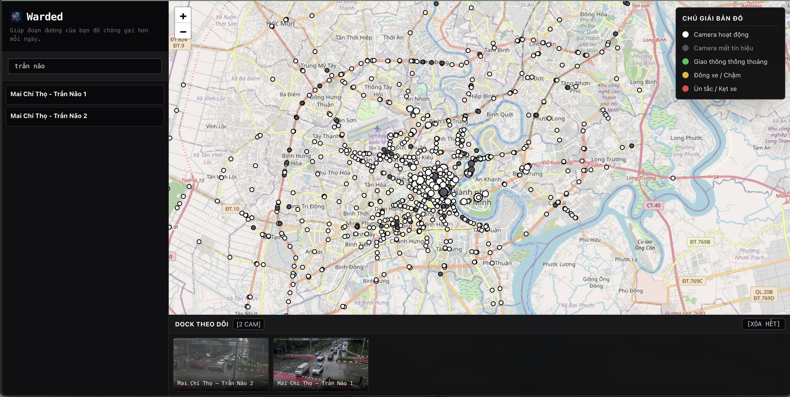
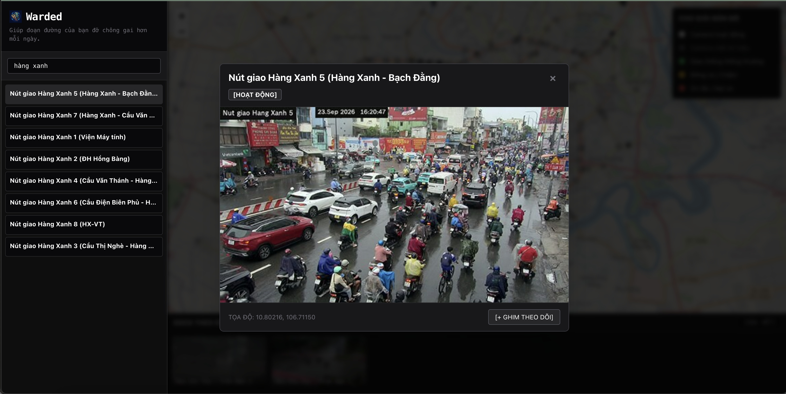
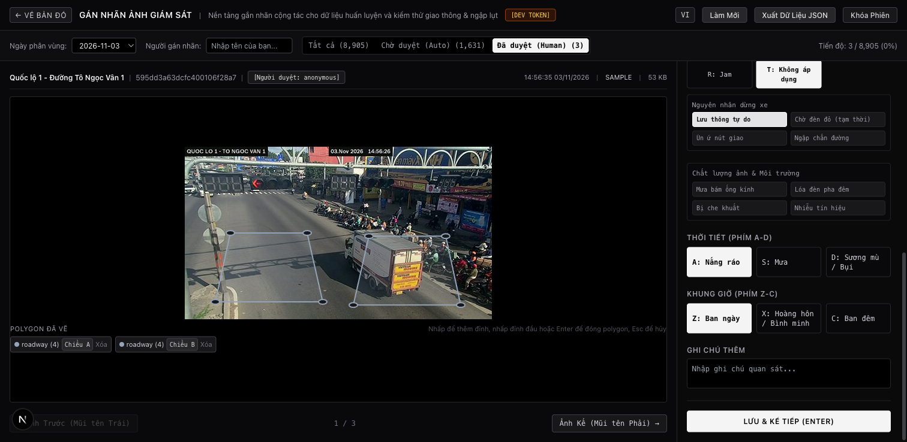

# CAMERA VIEW

<div align="center">

**Ho Chi Minh City Traffic Camera Monitor & Extensible Analytics**  
*Ứng Dụng Xem Camera Giao Thông TP. Hồ Chí Minh & Tính Năng Mở Rộng*

<p align="center">
  <a href="https://github.com/529-studio/projectKV/actions"></a>
  <a href="https://nextjs.org/"></a>
  <a href="https://www.typescriptlang.org/"></a>
  <a href="https://tailwindcss.com/"></a>
  <a href="https://www.framer.com/motion/"></a>
  <a href="https://leafletjs.com/"></a>
  <a href="https://go.dev/"></a>
  <a href="https://sqlite.org/"></a>
  <a href="docs/ADR-001-flood-alert-architecture.md#adr-003-sprint-1-scope--live-updates-sse-hot-set-scoped-congestion-colors-phường-based-filter"></a>
  <a href="https://open-meteo.com/"></a>
  <a href="https://www.rainviewer.com/api.html"></a>
  <a href="https://www.cloudflare.com/developer-platform/r2/"></a>
  <a href="https://python.org/"></a>
  <a href="LICENSE"></a>
</p>

[English](README.md#english) &nbsp;•&nbsp; [Tiếng Việt](README.vi.md)

<br />
<br />

<p align="center">
  
</p>
<p align="center">
  <em>Multi-Camera Corridor Tracking Dock & Map Explorer</em>
</p>

<br />

<p align="center">
  
</p>
<p align="center">
  <em>Live Camera Snapshot Modal with Traffic Verdict & Pin Control</em>
</p>

</div>

---

# English

> **Ho Chi Minh City traffic camera viewer and explorer optimized for low latency, clean monochromatic high-contrast UI, chained hierarchical filtering, multi-camera pin dock, and extensible modular architecture — extending toward real-time computer vision and flood alerting.**

The system is organized as a **clean monorepo**, decoupling the Web Client (`apps/web`) from a Go backend (`services/go-server`), with a separate Python service (`services/cv-engine`) for model inference. See [`docs/ADR-001-flood-alert-architecture.md`](docs/ADR-001-flood-alert-architecture.md) for the full architectural rationale.

## 1. Project Directory Structure (Monorepo)

```
hcm-traffic-cameras/
│
├── apps/
│   └── web/                           # [FRONTEND] Next.js App Router Client (@camera-view/web)
│       ├── src/
│       │   ├── app/                   # App Router pages & layout
│       │   ├── components/            # Leaflet map, docked tracking UI, modals, legends
│       │   ├── hooks/                 # useCameras, useTraffic (SSE EventSource)
│       │   └── config/                # API endpoints, map constants
│       ├── tailwind.config.ts         # Tailwind CSS styling
│       └── package.json
│
├── services/
│   ├── go-server/                     # [BACKEND — Go] Single static binary (Gin + SQLite + R2 Storage)
│   │   ├── cmd/
│   │   │   ├── server/main.go         # Composition root, routing, graceful shutdown
│   │   │   ├── notify-preview/main.go # CLI for single-source Telegram flood alert message preview
│   │   │   ├── sync-proofs/main.go    # High-concurrency Cloudflare R2 proofs sync CLI
│   │   │   └── verify-r2/main.go      # Cloudflare R2 connectivity verification tool
│   │   └── internal/
│   │       ├── live/                  # Server-Sent Events (SSE) hub & live stream endpoint
│   │       ├── camera/                # Camera catalog, Phường indexing, query endpoints
│   │       ├── proxycache/            # Snapshot reverse-proxy + in-memory TTL cache
│   │       ├── hotset/                # Hot Set Pool scheduler (see ADR-001 §2)
│   │       ├── storage/               # Pluggable object storage (LocalStorage & Cloudflare R2)
│   │       ├── archiver/              # Snapshot proof archiver with ICT (UTC+7) timezone standard
│   │       ├── harvester/             # Autonomous dual-trigger poller, label generator & R2 streamer
│   │       ├── notify/                # Notification Adapter: Telegram / Zalo / WebPush / SMS
│   │       ├── store/                 # SQLite (pure Go, no cgo) — subscriptions, dedupe, verdicts
│   │       └── tilecache/             # Offline/local map tile proxy and caching
│   │
│   └── cv-engine/                     # [ML PLANE — Python] Model inference on inference worker
│       ├── models/                    # YOLO / ONNX / OpenVINO IR FP16 weights
│       └── api.py                     # Multi-threaded OpenVINO detection endpoint (:8000)
│
├── tools/
│   ├── harvester/                     # [HARVESTER] 24/7 autonomous soak & frame capture daemon
│   │   └── service.py                 # 5-minute Hot Set harvester with WAL & soak telemetry (S11-T2)
│   ├── seg/                           # [SEGMENTATION PRE-LABELING] SAM-assisted batch toolchain (S9-T2)
│   │   ├── prelabel_sam.py            # Stream frames from R2, run MobileSAM + YOLOv8n, upload candidates
│   │   ├── sam_runtime.py             # ONNX runtime wrappers for ViT encoder & promptable decoder
│   │   └── contract.py                # Polygon annotation schema & validation contract
│   ├── eval/                          # [EVALUATION] Ground-truth benchmarks & label curation
│   │   ├── ingest_proof_archive.py    # 11,905-frame proof archive replay & SQLite populator (S11-T2)
│   │   ├── auto_harvest.py            # Standalone automated frame harvester & Draft-07 labeler CLI
│   │   ├── export_yolo_seg.py         # Standalone YOLO segmentation dataset exporter CLI (ADR-009)
│   │   ├── label_curator.py           # Taxonomy curation and legacy label cleansing
│   │   └── benchmark.py               # PCU & flood accuracy evaluation harness
│   ├── train/                         # [OFF-BOX TRAINING] Road surface water segmentation pipeline
│   │   ├── train_yolov8_seg.py        # Off-box YOLOv8-seg training & OpenVINO FP16 export
│   │   └── train_yolov8_seg_test.py   # Training pipeline & export unit tests
│   ├── storage/                       # [OBJECT STORAGE] Cloudflare R2 verification tooling
│   │   └── verify_r2.py               # Boto3 / R2 connectivity verification script
│   ├── geo-enrich/                    # [GEO ENRICHMENT] Batch Phường point-in-polygon tool
│   │   ├── enrich.py                  # CLI enrichment script (Ray casting / Shapely)
│   │   └── data/                      # GeoJSON boundary polygons
│   └── crawler/                       # [DATA CRAWLER]
│       └── get_all_cameras.js         # Fetch camera dataset from official DOT portal
│
├── scripts/
│   └── verify_staging_telegram.sh     # Ops pre-flight: live staging Telegram flood alert verification (Issue #246)
│
├── docs/
│   ├── SYSTEM_DESIGN.md               # Original caching & CV roadmap design
│   ├── GO_BACKEND_ARCHITECTURE.md     # Go backend service layout and runtime model
│   ├── ADR-001-flood-alert-architecture.md   # Flood-alert feasibility, Go migration & Sprint 1 scope
│   └── labeling_guidelines.md         # Label schema and annotation rules
│
├── cameras_all.json                   # Base traffic camera catalog dataset
├── cameras_enriched.json              # Enriched camera catalog with phuong_id / phuong_name
├── Makefile                           # Unified orchestration commands
├── LICENSE                            # GNU Affero General Public License v3.0
└── README.md                          # Project documentation
```

## 2. Quick Start

### 2.1. Basic Mode (UI & Backend without Local Model Inference)
Suitable for rapid UI development, offline testing, or lightweight exploration:

```bash
# Install dependencies (Go modules + frontend, first time only)
make install

# Launch Go backend (:3000) and Next.js frontend dev server (:3001) concurrently
make dev-all

# Or run the Go backend only (Port 3000) - Serves both API and Web Frontend
make dev-go

# (Optional) Run standalone static server for Frontend (Port 3001)
make dev-web

# Crawl & update camera dataset from official DOT portal
make crawl
```

### 2.2. Full-Stack with Local OpenVINO Model Inference (Recommended)
To run real AI vehicle detection and PCU saturation scoring locally using self-hosted OpenVINO (`yolov8n_openvino_320`):

```bash
# Step 1: Start the CV Engine container in the background (port 8000)
make dev-model
# (Equivalent to: docker compose -f docker-compose.local.yml up -d)

# Step 2: Ensure .env is configured for local OpenVINO inference:
# ANALYZER=onnx
# CV_ENGINE_URL=http://localhost:8000

# Step 3: Launch Go Backend (:3000) and Next.js Frontend (:3001)
make dev-all
```

#### Service Endpoints & Verification Matrix

| Service | Port | Endpoint URL | Verification Check |
|---|:---:|---|---|
| **Web Map Explorer** | `3001` | http://localhost:3001 | Interactive Leaflet map, corridor dock |
| **Collaborative Labeler** | `3001` | http://localhost:3001/labeler | Snapshot labeling tool with auto-harvest review filters, in-memory partition cache, Shift+Enter fast approval, and a segmentation mode for drawing 6-class polygon ground truth (ADR-011 D1) |
| **Go Backend API** | `3000` | http://localhost:3000 | Core Gin HTTP REST server |
| **Subscription API** | `3000` | http://localhost:3000/api/subscriptions | `POST`, `GET`, `DELETE` flood alert subscriptions |
| **Swagger UI** | `3000` | http://localhost:3000/swagger/index.html | Interactive OpenAPI documentation |
| **Backend Health** | `3000` | http://localhost:3000/health | Returns `{"status":"ok"}` |
| **CV Inference Engine** | `8000` | http://localhost:8000/healthz | Returns `{"status":"healthy","model":"yolov8n_openvino_320"}` |

> [!NOTE]
> `make dev-all` launches the Go backend and Next.js dev server. It expects the `warded-model` Docker container to be already running if `ANALYZER=onnx` is configured.

*   **Browser Access**:
    *   Full Application (Backend + Web): `http://localhost:3000`
    *   Standalone Frontend Dev: `http://localhost:3001`
    *   Collaborative Labeler: `http://localhost:3001/labeler`

### 2.3. Dataset Labeling & Model Training Workflow

The project incorporates an end-to-end active learning and computer vision pipeline — spanning automated snapshot harvesting, interactive quadrilateral/polygon ground-truth annotation, YOLOv8 segmentation dataset export, model training, and OpenVINO optimization.

#### Step 1: Frame Annotation & Directional Ground Truth (`/labeler`)

<p align="center">
  
</p>

Access the Collaborative Labeler at `http://localhost:3001/labeler`:
*   **Dual-Trigger Harvesting**: Frames are ingested continuously via scheduled peak harvests and weather-triggered rain watchers (`internal/harvester`), streamed to Cloudflare R2 object storage (`warded-proofs`).
*   **Assisted Pre-Labeling (SAM)**: Run `make prelabel-sam` (`tools/seg/prelabel_sam.py`) to stream R2 frames and generate MobileSAM + YOLOv8n polygon segment candidates for human review.
*   **Quadrilateral Roadway & Flood Polygons**: Annotators switch to polygon mode (`S`) to outline drivable roadways and inundation zones directly on camera snapshots:
    *   **Directional Roadway Polygons**: For the `roadway` class, annotators draw quadrilateral/polygon lane boundaries and assign directional flow — **Direction A** (`Chiều A`, near/approaching lane) or **Direction B** (`Chiều B`, far/receding lane). This isolates opposing traffic corridors for per-direction saturation and PCU ground truth.
    *   **Water & Flood Masks**: Delineate localized water bodies (`water_puddle`, `water_severe`) anchored to physical tire-depth markers.
    *   **Review Acceleration**: In-memory partition caching, hotkey accelerators (`Shift+Enter` to approve, `1`–`4` for traffic severity), and facet filtering (Rain, Daylight, Hot Set).

#### Step 2: Dataset Compilation & Directional Sidecar Export
Export annotated labels from `tools/eval/labels_gold_standard` into YOLO segmentation format:
```bash
make export-seg
# Runs: python3 tools/eval/export_yolo_seg.py --labels-dir tools/eval/labels_gold_standard --output-dir data/yolo_seg --verify
```
*   **Standard YOLO Polygon Labels**: Normalizes polygon vertices into standard Ultralytics YOLO segmentation `.txt` format (`0: roadway`) split into train/val/test partitions.
*   **Directional Roadway Sidecars**: Emits `roadway_regions.json` alongside masks, preserving exact normalized coordinates and lane flow (`a` vs `b`) for downstream traffic forecasting.

#### Step 3: Off-Box Training & OpenVINO Deployment
Train and export optimized inference weights:
```bash
# Fine-tune YOLOv8n-seg (EPOCHS=50) and export Intel OpenVINO FP16 IR
make train-seg

# Export + verify an existing fine-tuned checkpoint
make export-seg-openvino SEG_CHECKPOINT=runs/segment/train_yolov8n_seg/weights/best.pt

# Verify PCU saturation and flood segmentation accuracy against ground-truth benchmarks
make benchmark-real
```
The export converts the 6-class (42-channel) graph the cv-engine decodes to real FP16 IR and
refuses a re-initialised head (`--allow-untrained-head` is bootstrap-only). Evidence:
[`docs/reports/seg_eval_v3.md`](docs/reports/seg_eval_v3.md).

### 2.4. Verification, Forecast & Evidence Integrity Gates

* **Evidence Integrity Gate**: Run `make evidence-lint` (`tools/ci/check_evidence_integrity.py`) and `make test-ci` to enforce anti-spoofing, temporal invariants, and synthetic data prohibition across all release artifacts (ADR-013 D1).
* **Forecast Pipeline**: Run `make test-forecast` for suite, `make train-forecast` to refit, and `make train-forecast-daemon` for daemon scheduling. Provenance: [`docs/reports/forecast_prototype_v1.md`](docs/reports/forecast_prototype_v1.md).

## 3. Key Highlights

*   **Monochromatic & Intuitive Interface**: Minimalist high-contrast design using black, dark gray, and white tones.
*   **Bilingual i18n Support**: Instant switching between Vietnamese (`vi`, default) and English (`en`), persisted across sessions.
*   **Clean Standard OSM Basemap**: OpenStreetMap tiles, no watermark, geographically constrained to Southeastern Vietnam (`maxBounds`).
*   **Map Clutter Hygiene & Offline Camera Filtering**: Hides 135 offline or no-signal cameras (`status === 'NOT_IMAGE'` / `'NO_SIGNAL'`) by default, with a header counter and monochromatic toggle.
*   **Chained Deep Filter**: Multi-tier faceted filtering — *Zone* ➔ *Road / Corridor* ➔ *Intersection / Node*.
*   **Real-Time Arterial Marker Saturation Coloring**: Styles Hot Set markers from 30s ONNX PCU saturation: Clear (`#10b981`, $SI < 0.30$), Moderate (`#f59e0b`, $0.30 \le SI < 0.60$), Congested (`#ef4444`, $SI \ge 0.60$), with CSS pulse, tooltip metrics, and legend.
*   **Calibrated Doppler Rain Radar (S8-T1)**: RainViewer tiles at Zoom 8 with meteorological RGB reflectivity decoding (18–29 dBZ light, 30–39 moderate, $\ge 40$ heavy), hexagon quorum, and ground-camera cross-validation.
*   **Multi-Camera Corridor Tracking Dock**: Pin cameras into the bottom tracking dock with synchronized snapshot refresh.
*   **Human-in-the-Loop Flood Reporting (S8-T7)**: Commuter flood reports bridge live to SSE map streams and hex aggregators, with amber markers, 15m sliding TTL, and multi-reporter escalation.
*   **Directional Multi-Lane Taxonomy & Physical Flood Markers**: Classifies traffic density independently by direction (Direction A approaching vs Direction B receding) to resolve asymmetric divided boulevards, and anchors flood severity to physical wheel-depth markers.
*   **Physical Flood Hazard Levels (cm)**: Depth anchored to the in-frame 110 cm motorcycle reference (per-camera overrides ±25%); the 15 cm curb reference is deferred until a curb segmenter lands. Three stall-risk bands plus an avoidance-inferred Level 3 for upstream-stopped traffic — never a fabricated depth.
*   **Responsive Layout (100dvh)**: Desktop, tablet, and smartphone friendly with collapsible legend and mobile bottom-sheet drawer.
*   **Go Backend**: Single static binary, no runtime dependency install, in-memory + SQLite state, goroutine-based Hot Set scheduler.
*   **Cloudflare R2 Object Storage**: S3-compatible storage (`warded-proofs`) for snapshot proofs, distributed via edge CDN for team labeling workflows.

### Microservice Architecture & Host Topology

| Service | Technology | Port | Host & Node Role | Primary Responsibilities |
|---|---|:---:|---|---|
| **Web Client** (`apps/web`) | Next.js 15, React 19, Tailwind CSS, Leaflet | `3001` | `edge host` | Map visualization, discrete camera marker dots, H3 hex overlays, horizontal corridor dock, bilingual UI (`vi` / `en`). |
| **Backend API** (`services/go-server`) | Go 1.26, Gin, SQLite (WAL mode) | `3000` | `edge host` | Snapshot proxy cache, camera catalog, hotset scheduler, flood report archiver, PCU Saturation Index, SSE stream, R2 storage. |
| **CV Engine** (`services/cv-engine`) | Python 3.11, ThreadingHTTPServer, OpenVINO IR, YOLOv8n-seg FP16 | `8000` | `inference worker` | Vehicle detection, directional roadway assignment, water segmentation (`POST /predict`), Dual-Layer Physical Triangulation, `GET /healthz`. |
| **Storage & Edge CDN** | Cloudflare R2, AWS Signature V4 | `443` | Cloudflare Edge (`file.529studio.site`) | S3-compatible snapshot proof repository (`warded-proofs`), Vietnam ICT (`UTC+7`) key hierarchy (`YYYY-MM-DD/<camera_id>/<unix_ts>_<reason>.jpg`). |

### Tech Stack & Core Libraries

| Layer | Technologies | Purpose |
|---|---|---|
| **Frontend** | [Next.js 15.5+](https://nextjs.org/), [TypeScript 5](https://www.typescriptlang.org/), [Tailwind CSS 3.4](https://tailwindcss.com/), [Framer Motion](https://www.framer.com/motion/), [Leaflet](https://leafletjs.com/) | App Router client, responsive UI, interactive GIS map |
| **Backend** | [Go 1.26+](https://go.dev/), [Gin](https://gin-gonic.com/), [SQLite 3](https://sqlite.org/), [SSE](docs/ADR-001-flood-alert-architecture.md#adr-003-sprint-1-scope--live-updates-sse-hot-set-scoped-congestion-colors-phường-based-filter) | Single static binary, proxy caching, Hot Set scheduler, live streams |
| **Cloud Storage** | [Cloudflare R2](https://www.cloudflare.com/developer-platform/r2/), [AWS SDK v2 (Go)](https://github.com/aws/aws-sdk-go-v2) | S3-compatible snapshot proofs (`warded-proofs`), public edge delivery |
| **Computer Vision** | [Python 3.11+](https://python.org/), [PyTorch](https://pytorch.org/), [OpenCV](https://opencv.org/), [Intel OpenVINO](https://openvino.ai/) | High-throughput vehicle detection and road surface water segmentation |
| **Weather & Radar** | [Open-Meteo](https://open-meteo.com/), [RainViewer API](https://www.rainviewer.com/api.html) | Real-time rainfall metrics and composite Doppler radar reflectivity tiles |
| **Tooling & Ops** | [GitHub Actions](https://github.com/features/actions), [AGPLv3](LICENSE), [Shapely](tools/geo-enrich) | CI/CD, golangci-lint, boundary enrichment |

### Configuration Reference

#### Backend Service (`services/go-server`)

| Variable | Default Value | Description |
|---|---|---|
| `PORT` | `3000` | HTTP service port |
| `STORAGE_DRIVER` | `local` | Storage driver (`local` for disk or `r2` / `s3` for Cloudflare R2) |
| `STORAGE_LOCAL_ROOT` | `./data/proofs` | Root directory for local snapshot archiving |
| `R2_ACCOUNT_ID` | `<your-account-id>` | Cloudflare Account Identifier |
| `R2_ENDPOINT` | `https://<account_id>.r2.cloudflarestorage.com` | Base S3 API endpoint for Cloudflare R2 |
| `R2_BUCKET_NAME` | `warded-proofs` | Object storage bucket name |
| `R2_REGION` | `auto` | R2 signing region |
| `R2_PUBLIC_URL` | `https://file.529studio.site` | Cloudflare Edge CDN custom domain |
| `CV_ENGINE_URL` | `http://localhost:8000` | URL of self-hosted CV inference worker |
| `ANALYZER` | `none` | Traffic analyzer (`none`, `mock`, `vlm`, `onnx`) |
| `SNAPSHOT_UPSTREAM_BASE_URL` | *(required)* | DOT upstream image snapshot endpoint |
| `TELEGRAM_BOT_TOKEN` | `""` | Bot API token; empty keeps dispatch in simulation mode |
| `TELEGRAM_BOT_USERNAME` | `""` | Public bot handle for deep links; empty disables the webhook |
| `TELEGRAM_WEBHOOK_SECRET` | `""` | Webhook secret (`openssl rand -hex 32`); empty disables the webhook |
| `TELEGRAM_DEBOUNCE_MINUTES` | `30` | Per-chokepoint anti-spam debounce window (minutes) |
| `HARVESTER_ENABLED` | `false` | Enable background dual-trigger scheduled & rain harvester |
| `HARVESTER_SCHEDULE_HOURS` | `7,12,17` | Daily peak harvest schedule in ICT (UTC+7, e.g. `07:30,12:00,17:30`) |
| `HARVESTER_RAIN_COOLDOWN_MINUTES` | `60` | Sliding window cooldown for rain watcher triggers (in minutes) |
| `HARVESTER_CONCURRENCY` | `15` | Worker pool concurrency for frame ingestion & R2 streaming |
| `HARVESTER_CATCHUP_MINUTES` | `120` | Boot-time catch-up window: slots missed by a late start or restart fire once at startup (0 disables) |

#### CV Model Service (`services/cv-engine`)

| Parameter | Configuration | Description |
|---|---|---|
| **Host Worker** | `inference worker` | Dedicated multi-core host with private mesh VPN |
| **Model Runtime** | Intel OpenVINO 2024.4 IR | Optimized FP16 vehicle detection engine (~6.3 MB) |
| **Input Resolution** | 416x416 default; `CV_INPUT_RESOLUTION` (320/416/640) | Restart-scoped override; per-request `X-Target-Resolution` (320/416) |
| **Resource Caps** | 2 vCPU / 2 GB RAM | Resource limits configured via Docker Compose stack |
| **API Endpoints** | `POST /predict`, `GET /healthz`, `GET /info` | JPEG prediction; `/info` reports compiled geometry |

Operations: [Inference Worker Capacity Runbook](docs/runbooks/inference_worker_capacity.md).

#### Operational Verification: Staging Telegram Flood Alerts

Citizens subscribe from the bell button in the web UI (city-wide, zone, ward or
chokepoint); the bot answers `/start`, `/status`, `/stop` and `/help`. Verify
live delivery on staging before enabling public subscriptions:

```bash
# Credentials are read from environment variables or the gitignored .env (never hardcoded)
TELEGRAM_BOT_TOKEN=<your-telegram-bot-token> TELEGRAM_CHAT_ID=<your-telegram-chat-id> \
  ./scripts/verify_staging_telegram.sh
```

The script checks `getMe`, the bilingual zero-emoji copy and a real `sendMessage`
(HTTP 200). The inbound `POST /api/notify/telegram/webhook` is mounted only when
`TELEGRAM_BOT_TOKEN`, `TELEGRAM_BOT_USERNAME` and `TELEGRAM_WEBHOOK_SECRET` are
all valid; otherwise it answers `404` (fail-closed).

## 4. Next Evolution Steps

Architecture decisions:
**[`docs/SYSTEM_DESIGN.md`](docs/SYSTEM_DESIGN.md)** — caching and CV roadmap
**[`docs/ADR-001-flood-alert-architecture.md`](docs/ADR-001-flood-alert-architecture.md)** — flood-alert feasibility, channels, Go backend migration (ADR-002)
**[`docs/ADR-009-zero-vlm-flood-segmentation.md`](docs/ADR-009-zero-vlm-flood-segmentation.md)** — self-hosted segmentation, OpenVINO benchmarks, dual-layer physical triangulation (Zero-VLM)

## License

This project is licensed under the **GNU Affero General Public License v3.0**
(AGPL-3.0). See [`LICENSE`](LICENSE) for the full text.

AGPL-3.0 is a copyleft license with a network clause: if you run a modified
version of this software as a network service, you must make the corresponding
source code available to the users of that service. Self-hosting an unmodified
copy requires no additional obligation.

- Contributions are accepted under the same license, see [`CONTRIBUTING.md`](CONTRIBUTING.md).
- Security reports follow [`SECURITY.md`](SECURITY.md).

