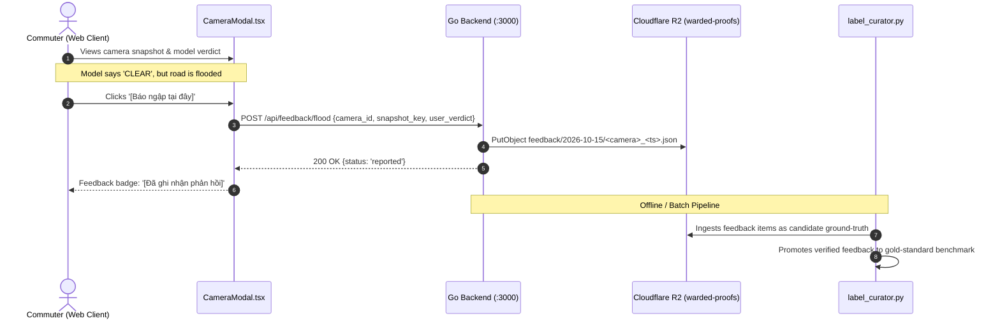
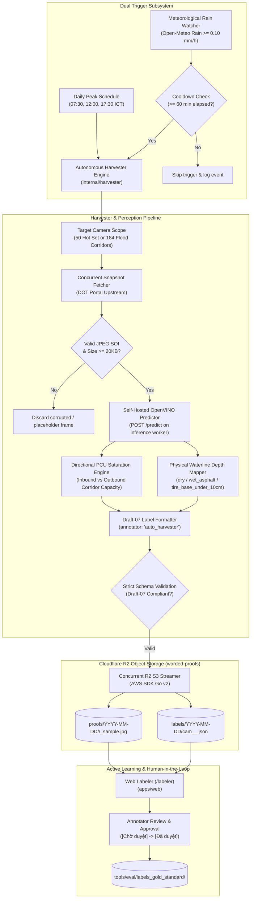

# ADR-009: Self-Hosted Flood Segmentation, Directional Multi-Lane PCU & Autonomous Ground-Truth Data Flywheel

**Status:** Approved  
**Date:** 2026-10-15 (Revised: 2026-10-16)  
**Governing Issue:** Issue #254 (S7-T9), Issue #253 (S7-T8), Issue #261 (S7-T9b), Issue #262 (S7-T7b)  
**Authors:** AI Agentic Engineering Team & Core System Architects  
**Supersedes/Extends:** ADR-001 (Flood Alert Feasibility), ADR-004 (Real Frame Evaluation), ADR-005 (PCU Calibration), ADR-008 (Sprint 7 Architecture Roadmap)  

---

## 1. Context & Problem Statement

Post-Sprint 6 architectural audits, empirical D6 real-world evaluations, and developer team discussions identified four critical operational and architectural constraints in the current computer vision and data pipeline:

1. **The Runtime VLM Dilemma**:
   - Initial experimental prototypes explored cloud Vision Language Models (VLM) for zero-shot flood verification in modal views.
   - **Constraint**: Cloud VLM APIs incur unpredictable per-request latency (1.5s - 4.0s), rate-limit throttling (10 RPM / 300 RPD), per-call financial costs, and external network dependencies. For a city-wide system monitoring 800+ cameras with 30s polling intervals, cloud VLM calls are structurally infeasible at production scale.
   - **Decision**: The runtime telemetry system will **never** call external VLM or Gemini APIs. All inference must execute strictly locally or on dedicated self-hosted nodes (`inference worker` worker) using CPU-optimized open-source runtimes (Intel OpenVINO).

2. **The Directional Congestion Paradox (The Two-Way Road Flaw)**:
   - On major dual-carriageway boulevards (e.g., Võ Văn Kiệt, Mai Chí Thọ, Điện Biên Phủ), morning rush-hour traffic moving inbound toward District 1 is frequently in complete breakdown (`CONGESTED`), while outbound lanes toward Thủ Đức or Bình Chánh are completely clear (`CLEAR`).
   - The legacy `pcu.go` engine aggregated all detected vehicle bounding boxes across the entire image into a single scalar PCU score. This collapsed opposing flows into a single global status, giving outbound commuters false alarms and confusing model benchmarks.

3. **Human-in-the-Loop Active Learning Flywheel**:
   - Rather than relying on cloud AI to guess ground truth, commuters experiencing real conditions provide the most authoritative ground-truth validation. When a camera modal presents a snapshot, users can click `[Báo ngập tại đây]` (Report flood).
   - This crowd-verified interaction captures the authentic camera frame, packages environmental telemetry, and archives it directly to Cloudflare R2 (`feedback/{date}/{camera_id}_{ts}.json`) for evaluation and model retraining.

4. **Reconciliation & Deprecation of Cloud VLM Bridge (Issue #252 Superseded)**:
   - Sprint 7 originally proposed Issue #252 (`[go-server] S7-T7 — Rain-Triggered Automated Hot Set Flood Poller (VLM Bridge)`).
   - However, in light of the Runtime VLM Dilemma (§1.1) and empirical frame collection on 2026-10-15 and 2026-10-16, calling cloud VLM automatically during rain events would rapidly exhaust the 300 RPD quota within 1-2 hours of rainfall, while introducing third-party failure modes.
   - **Decision**: Issue #252 is **formally closed and superseded** by Issue #261 (ADR-009 revision) and Issue #262 (**`internal/harvester` Autonomous Dual-Trigger Poller & Ground-Truth Archiver**). The autonomous pipeline operates 100% on-premise using self-hosted OpenVINO + meteorological triggers + Cloudflare R2 archival, completely eliminating cloud VLM dependency.

---

## 2. Decision Matrix & Architectural Approach

### 2.1. Dual-Lane Directional Partitioning (Traffic Congestion)

To resolve the two-way road flaw without requiring complex multi-camera 3D tracking:
1. **Vertical/Horizontal Bounding Box Centroid Splitting**:
   - Each traffic camera has a known optical orientation (calibrated per camera or inferred from predominant vehicle heading).
   - Bounding boxes detected by the self-hosted YOLOv8n detector are partitioned into **Direction A** (Near-lane / Inbound) and **Direction B** (Far-lane / Outbound) based on bounding box vertical ($y$) or horizontal ($x$) centroids relative to the roadway median line.
2. **Directional PCU Saturation**:
   $$\text{SI}(\text{Dir A}) = \frac{\text{PCU}(\text{Dir A})}{\text{Capacity}(\text{Dir A})}, \quad \text{SI}(\text{Dir B}) = \frac{\text{PCU}(\text{Dir B})}{\text{Capacity}(\text{Dir B})}$$
3. **Rollup Rule**:
   - Global Map Status: $\max(\text{Severity}(\text{Dir A}), \text{Severity}(\text{Dir B}))$.
   - Modal & Dock Detail: Surfaces directional labels (e.g. `Hướng Q1: Kẹt xe | Hướng Thủ Đức: Thông thoáng`).

### 2.2. Self-Hosted Road Surface Water Segmentation Spike

For flood detection, the system transitions from synthetic corridor heuristics to direct physical water surface analysis:
1. **Model Architecture**:
   - Lightweight semantic segmentation: **YOLOv8n-seg** or **MobileNetV3-UNet** converted to Intel OpenVINO IR FP16.
   - Target Classes: `roadway` and `standing_water`.
2. **Physical Immersion Depth Heuristics**:
   - **Water Area Ratio ($R_{\text{water}}$)**: Ratio of segmented water pixels within the roadway mask.
   - If $R_{\text{water}} < 0.05$: `NONE` (dry or isolated puddles).
   - If $0.05 \le R_{\text{water}} < 0.25$: `SHALLOW` (localized pooling, tire base submerged $<10\text{ cm}$).
   - If $R_{\text{water}} \ge 0.25$ with vehicle wheel intersection: `DEEP` ($>15-20\text{ cm}$).
3. **Execution Runtime**:
   - Runs on the existing `inference worker` node (2 vCPU / 2 GB RAM capped) at $>20\text{ FPS}$ with $<30\text{ ms}$ latency per frame, fully decoupling from cloud APIs.

### 2.3. Crowdsourced Feedback Ingestion Pipeline

### 2.4. Autonomous Continuous Data Flywheel (Daily & Rain-Triggered Harvesting Pipeline)

To continuously expand the real evaluation dataset and keep ground truth synchronized without manual intervention:

#### A. Trigger Invariants
1. **Daily Scheduled Clock**:
   - Configurable peak hours: `07:30`, `12:00`, `17:30` ICT (rush hour onset, midday baseline, evening rush).
   - Scope: 57 Arterial Hot Set cameras (high traffic significance, 100% online).
2. **Meteorological Rain Watcher**:
   - Polling source: `weather.Service` (Open-Meteo current API, cached 10m TTL).
   - Trigger condition: `Precipitation >= 0.10 mm/h` OR rain WMO weather codes (51, 53, 55, 61, 63, 65, 80, 81, 82).
   - **Sliding Cooldown**: Strictly requires $\ge 60\text{ minutes}$ since the last rain harvesting run before re-triggering, preventing upstream rate-limit exhaustion during multi-hour downpours.
   - Scope: 184 flood-prone corridor and municipal flood chokepoint cameras.

#### B. Storage Hierarchy on Cloudflare R2 (`warded-proofs`)
All assets conform to uniform UTC+7 Vietnam ICT date partitioning:
- **Proof frames**: `proofs/<YYYY-MM-DD>/<camera_id>/<unix_ts>_sample.jpg`
- **Auto-generated labels**: `labels/<YYYY-MM-DD>/cam_<camera_id>_<unix_ts>.json`
- **Commuter feedback**: `feedback/<YYYY-MM-DD>/<camera_id>_<annotator>_<unix_ts>.json`
- **Gold-standard ground truth**: `gold_standard/cam_<camera_id>_<unix_ts>.json`

#### C. Schema & Invariant Enforcement
Every generated label must satisfy `tools/eval/label_schema.json` (Draft-07 specification) before being uploaded:
- Required root fields: `frame_id`, `image_path`, `labels`, `annotator`, `annotated_at`.
- `annotator`: Strictly tagged as `"auto_harvester"` to distinguish machine-generated pseudo-labels from human ground truth.
- `flood_submersion_anchor`: Set dynamically based on meteorological telemetry (`dry` during dry weather; `wet_asphalt_no_standing` during rainfall; `tire_base_under_10cm` on persistent chokepoint flooding).

#### D. Human-in-the-Loop Fast Certification
In `apps/web/src/app/labeler`:
- Candidate queue displays status filter pills: `[Tất cả]`, `[Chờ duyệt (Auto)]`, `[Đã duyệt (Human)]`.
- Reviewers inspect auto-generated annotations and press `Shift + Enter` to instantly certify the pseudo-label into the gold-standard dataset, converting `annotator: "auto_harvester"` into `annotator: "<reviewer_nickname>"`.

---

## 3. Consequences & Trade-offs

### Positive
- **Zero Ongoing API Costs**: $0 incurred for cloud VLM or Gemini vision tokens ($111/mo saved).
- **Zero Human Friction in Dataset Harvesting**: Daily snapshots and rainstorms are captured automatically into Cloudflare R2 without manual script execution.
- **Predictable Real-Time Latency**: Self-hosted OpenVINO inference executes consistently in $18-25\text{ ms}$, ensuring snappy UI updates.
- **Directional Clarity**: Eliminates false traffic jam alerts for commuters traveling in the clear direction on divided arterials.
- **Continuous Model Improvement**: Real commuter corrections and auto-harvested frames continuously populate the R2 repository, creating an authentic dataset of challenging edge cases.

### Negative / Mitigations
- **Upstream Portal Courtesy**: Scraping hundreds of cameras too frequently could trigger HTTP 429 throttling.
  - *Mitigation*: Maximum concurrency capped at 15 workers with 60-minute sliding cooldown on rain triggers and restricted camera scopes (57 Hot Set for scheduled, 184 for rain).
- **Camera Calibration Overhead**: Multi-lane directional splitting requires defining dividing lines for cameras with atypical angles.
  - *Mitigation*: Fall back to single-flow calculation for complex multi-leg roundabouts or uncalibrated views.

---

## 4. Implementation Sequencing (Sprint 7 Backlog)

1. **Sprint 7 Wave 1 (Completed)**:
   - S7-T2 (Issue #247): Hide offline cameras by default on map (PR #257).
   - S7-T8 (Issue #253): Multi-lane directional taxonomy & Draft-07 schema (PR #258).
   - S7-T3 (Issue #248): Human-in-the-loop `[Báo cáo ngập tại đây]` button (PR #259).
   - 2026-10-16 Frame Collection & Gold-Standard Dataset Curation (PR #260).

2. **Sprint 7 Wave 2 (Autonomous Data Flywheel & Saturation Telemetry)**:
   - **S7-T9b (Issue #261)**: Revise ADR-009 Autonomous Continuous Data Flywheel & Reconcile S7-T7 VLM Deprecation.
   - **S7-T7b (Issue #262)**: `internal/harvester` Autonomous Dual-Trigger Poller, Label Generator & Cloudflare R2 Archiver.
   - **S7-T7c (Issue #263)**: Standalone Automated Harvester CLI (`tools/eval/auto_harvest.py`).
   - **S7-T7d (Issue #264)**: Web Labeler Candidate Review Filter & Auto-Harvest Verification Badges.
   - **S7-T5 (Issue #250)**: Autonomous 50 Hot Set Traffic Poller & Saturation Cache.
   - **S7-T6 (Issue #251)**: Real-Time Arterial Marker Saturation Coloring (Green / Yellow / Red Dots).

3. **Sprint 7 Wave 3 (Spike & Closeout)**:
   - **S7-T4 (Issue #249)**: `internal/feedback` Leaf Package & Cloudflare R2 Ground-Truth Archiver.
   - **S7-T9 (Issue #254)**: ADR-009 Technical Design Spike: Self-Hosted Flood Segmentation.
   - **S7-T10 (Issue #255)**: Holistic Repository Knowledge Synchronization & Sprint 7 Closeout.
