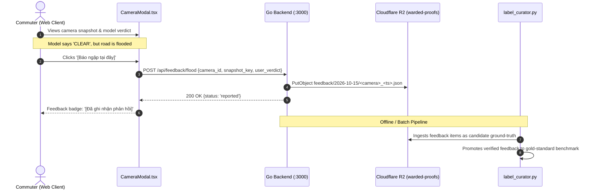

# ADR-009: Self-Hosted Flood Segmentation & Directional Multi-Lane Computer Vision Architecture

**Status:** Approved  
**Date:** 2026-10-15  
**Governing Issue:** Issue #254 (Sprint 7 Task S7-T9) & Issue #253 (S7-T8)  
**Authors:** AI Agentic Engineering Team & Core System Architects  
**Supersedes/Extends:** ADR-001 (Flood Alert Feasibility), ADR-004 (Real Frame Evaluation), ADR-005 (PCU Calibration)  

---

## 1. Context & Problem Statement

Post-Sprint 6 architectural audits and developer team discussions identified three critical operational and architectural constraints in the current computer vision pipeline:

1. **The Runtime VLM Dilemma**:
   - Initial experimental prototypes utilized Gemini Vision Language Models (VLM) for zero-shot flood verification in modal views.
   - **Constraint**: Cloud VLM APIs incur unpredictable per-request latency (1.5s - 4.0s), rate-limit throttling, per-call financial costs, and external network dependency. For a city-wide system monitoring 800+ cameras with 30s polling intervals, cloud VLM calls are structurally infeasible at production scale.
   - **Decision**: The system will **never** call external VLM or Gemini APIs at runtime. All inference must execute strictly locally or on dedicated self-hosted nodes (`inference worker` worker) using CPU-optimized open-source runtimes (Intel OpenVINO).

2. **The Directional Congestion Paradox (The Two-Way Road Flaw)**:
   - On major dual-carriageway boulevards (e.g., Võ Văn Kiệt, Mai Chí Thọ, Điện Biên Phủ), morning rush-hour traffic moving inbound toward District 1 is frequently in complete breakdown (`CONGESTED`), while outbound lanes toward Thủ Đức or Bình Chánh are completely clear (`CLEAR`).
   - The legacy `pcu.go` engine aggregated all detected vehicle bounding boxes across the entire image into a single scalar PCU score. This collapsed opposing flows into a single global status, giving outbound commuters false alarms and confusing model benchmarks.

3. **Human-in-the-Loop Active Learning Flywheel**:
   - Rather than relying on cloud AI to guess ground truth, commuters experiencing real conditions provide the most authoritative ground-truth validation. When a camera modal presents a snapshot, users can click `[Báo ngập tại đây]` (Report flood).
   - This crowd-verified interaction captures the authentic camera frame, packages environmental telemetry, and archives it directly to Cloudflare R2 (`feedback/{date}/{camera_id}_{ts}.json`) for evaluation and retraining.

---

## 2. Decision Matrix & Architectural Approach

### 2.1. Dual-Lane Directional Partitioning (Traffic Congestion)

To resolve the two-way road flaw without requiring complex multi-camera 3D tracking:
1. **Vertical/Horizontal Bounding Box Centroid Splitting**:
   - Each traffic camera has a known optical orientation (calibrated per camera or inferred from predominant vehicle heading).
   - Bounding boxes detected by the self-hosted YOLOv8n detector are partitioned into **Direction A** (Near-lane / Inbound) and **Direction B** (Far-lane / Outbound) based on bounding box vertical ($y$) or horizontal ($x$) centroids relative to the roadway median line.
2. **Directional PCU Saturation**:
   $$\text{SI}(\text{Dir A}) = \frac{\text{PCU}(\text{Dir A})}{\text{Capacity}(\text{Dir A})}, \quad \text{SI}(\text{Dir B}) = \frac{\text{PCU}(\text{Dir B})}{\text{Capacity}(\text{Dir B})}$$
3. **Rollup Rule**:
   - Global Map Status: $\max(\text{Severity}(\text{Dir A}), \text{Severity}(\text{Dir B}))$.
   - Modal & Dock Detail: Surfaces directional labels (e.g. `Hướng Q1: Kẹt xe | Hướng Thủ Đức: Thông thoáng`).

### 2.2. Self-Hosted Road Surface Water Segmentation Spike

For flood detection, the system transitions from synthetic corridor heuristics to direct physical water surface analysis:
1. **Model Architecture**:
   - Lightweight semantic segmentation: **YOLOv8n-seg** or **MobileNetV3-UNet** converted to Intel OpenVINO IR FP16.
   - Target Classes: `roadway` and `standing_water`.
2. **Physical Immersion Depth Heuristics**:
   - **Water Area Ratio ($R_{\text{water}}$)**: Ratio of segmented water pixels within the roadway mask.
   - If $R_{\text{water}} < 0.05$: `NONE` (dry or isolated puddles).
   - If $0.05 \le R_{\text{water}} < 0.25$: `SHALLOW` (localized pooling, tire base submerged $<10\text{ cm}$).
   - If $R_{\text{water}} \ge 0.25$ with vehicle wheel intersection: `DEEP` ($>15-20\text{ cm}$).
3. **Execution Runtime**:
   - Runs on the existing `inference worker` node (2 vCPU / 2 GB RAM capped) at $>20\text{ FPS}$ with $<30\text{ ms}$ latency per frame, fully decoupling from cloud APIs.

### 2.3. Crowdsourced Feedback Ingestion Pipeline

---

## 3. Consequences & Trade-offs

### Positive
- **Zero Ongoing API Costs**: $0 incurred for cloud VLM or Gemini vision tokens.
- **Predictable Real-Time Latency**: Self-hosted OpenVINO inference executes consistently in $18-25\text{ ms}$, ensuring snappy UI updates.
- **Directional Clarity**: Eliminates false traffic jam alerts for commuters traveling in the clear direction on divided arterials.
- **Continuous Model Improvement**: Real commuter corrections continuously populate the R2 feedback repository, creating an authentic dataset of challenging edge cases.

### Negative / Mitigations
- **Camera Calibration Overhead**: Multi-lane directional splitting requires defining dividing lines for cameras with atypical angles.
  - *Mitigation*: Fall back to single-flow calculation for complex multi-leg roundabouts or uncalibrated views.

---

## 4. Implementation Sequencing

1. **Sprint 7 Wave 1**: S7-T2 (Hide offline cameras - PR #257), S7-T3 (Report flood modal button), S7-T4 (R2 feedback ingestion API).
2. **Sprint 7 Wave 2**: S7-T5 (50 hot set poller), S7-T6 (Real-time saturation map coloring).
3. **Sprint 7 Wave 3**: S7-T8 (Directional taxonomy - completed), S7-T9 (Self-hosted segmentation spike), S7-T10 (Sprint 7 closeout & sync).
