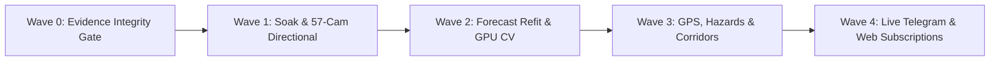

# ADR-013: Sprint 10 Reality-Check Audit Reconciliation & Sprint 11 Architecture Plan — Evidence Integrity, Ground-Truth Flywheels, and Commuter Last-Mile Utility

**Status**: Accepted  
**Date**: 2026-11-09  
**Authors**: ProjectKV Engineering & Architecture Team  
**Auditor**: Independent Technical Auditor & Devil's Advocate  
**Governing Documents**: `AGENTS.md` (Rules 1–11, especially Rule 2: *Never fear effort, never choose sloppy shortcuts*), `docs/GO_BACKEND_ARCHITECTURE.md`, `docs/reports/sprint10_report.md`  
**Related**:
- [`sprint10_report.md`](reports/sprint10_report.md) (Sprint 10 completion, verification and reality audit findings F1–F6)
- [`sprint9_report.md`](reports/sprint9_report.md) (Sprint 9 predecessor record)
- [`seg_eval_v2.md`](reports/seg_eval_v2.md) (dataset v2 evaluation)
- [`forecast_ablation_v2.md`](reports/forecast_ablation_v2.md) and [`forecast_feature_store_v2.md`](reports/forecast_feature_store_v2.md)
- [`cotenancy_benchmark_v1.md`](reports/cotenancy_benchmark_v1.md) and [`inference_worker_capacity.md`](runbooks/inference_worker_capacity.md)
- [`lessons/INDEX.md`](lessons/INDEX.md) (Lessons 69–76 codified in Sprint 10)

---

## Navigation Aid (Table of Contents)

1. [Context & Retrospective Reality-Check Audit](#1-context--retrospective-reality-check-audit)
2. [Architectural Decisions (D1–D6)](#2-architectural-decisions-d1d6)
3. [Sprint 11 Wave Schedule & Ticket Map](#3-sprint-11-wave-schedule--ticket-map)
4. [Capacity, Estimates & Delivery Envelope (Rule 3)](#4-capacity-estimates--delivery-envelope-rule-3)

---

## 1. Context & Retrospective Reality-Check Audit

Sprint 10 achieved 100% ticket delivery (PRs #381, #383, #384, #385, #386, #387, #388, #392) and
solidified software architecture: canonical forecast endpoints, subscription taxonomy
reconciliation, schema boot assertions, directional metadata ingestion, and cgroup isolation.
However, joint auditing by the Devil's Advocate agent and OpenCode revealed that Sprint 10 built
scaffolding over synthetic fixtures, placeholder stubs, and empty production tables:

### 1.1 Acceptance Verdicts & Reality Findings (F1–F6)

- **F1 (Synthetic Forecast Tautology)**: Forecast ablation (`forecast_ablation_v2.md`) passed on
  `synthetic_congestion_v2_5m.csv` generated by `generate_v2_fixture.py`, which directly injects
  rain into target congestion. Production `hotset_verdict_history` contained 0 rows. The endpoint
  is fail-closed (503/422). *Action: Build an automated refit worker fitted on 14-day live history.*
- **F2 (Fabricated Staging Soak Timestamps)**: Soak log `harvester_observation.json` recorded
  future timestamps (Nov 7–10) committed on Nov 6 via `verify_flywheel_soak.py`.
  *Action: Enforce CI timestamp validation; execute authentic 14-day unattended staging soak.*
- **F3 (Directional Coverage Vacuum)**: Directional runtime ingestion is implemented, but only
  **3 of 57 cameras (5.26%)** have polygons in `data/roadway_regions/`. The remaining 54 cameras
  dilute asymmetric gridlocks. *Action: Annotate dual directions for all remaining 54 cameras.*
- **F4 (64 KB Dummy OpenVINO Stub)**: Committed `models/yolov8n_seg_openvino_416/yolov8n_seg.bin`
  is a 65,536-byte dummy stub of repeating bytes. Real 6.4 MB FP16 weights were never deployed.
  *Action: Execute genuine GPU training on 550+ verified frames and deploy real 6.4 MB weights.*
- **F5 (Telegram Bot Simulation & Zero Subscription UI)**: Telegram alerts run in simulation mode
  without live tokens (#246); `apps/web` has zero subscription UI. Zero citizens receive alerts.
  *Action: Provision live bot token in Stack 14; build bilingual subscription modal in web.*
- **F6 (The Saigon Commuter Reality Gap)**: System outputs abstract math (SI 0.72, IoU 0.624).
  Commuters on motorbikes need physical survival metrics: "Will my exhaust stall?", "Locate flood
  hotspots near me via GPS", and "Which arterial corridor avoids flooded lanes?".
  *Action: Implement motorbike stall hazard classifier, 1-click GPS Near-Me, and corridor check.*

---

## 2. Architectural Decisions (D1–D6)

### D1. Evidence Integrity CI Gate & Hardened Definition of Done

- **Policy Amendment (Rule 10)**:
  1. No synthetic artifact may satisfy a release gate. A gate must consume an artifact whose
     provenance is `live`, `replayed`, or `human`. `synthetic` fixtures may test harnesses only.
  2. Evidence timestamps are asserted: `generated_at >= window.end` for any windowed soak evidence.
  3. Screenshots in `docs/proofs/` must come from the running containerized application, never
     static HTML mockups.
- **Enforcement**: New CI job `tools/ci/check_evidence_integrity.py` validates all files under
  `docs/reports/` and `docs/proofs/` on every pull request.

### D2. Authentic 14-Day Staging Soak & Ingestion of 11,905 Proof Frames

- **Harvester Soak**: Background harvester runs 24/7 on staging across the 57 Hot Set cameras on a
  strict 5-minute interval, populating continuous history in `hotset_verdict_history`.
- **Proof Archive Ingestion**: Ingest the 11,905 historical frames (1.4 GB) captured on 2026-11-03
  under `services/go-server/data/proofs/` into the labeling and training replay pool.

### D3. Directional Roadway Registry Scale-Out (57/57 Hot Set Cameras)

- Dual-direction polygons (`dir_a`, `dir_b`) and normalized capacity shares (`share_a + share_b = 1.0`)
  annotated for all 54 remaining Hot Set cameras using `/labeler`.
- Exports validated by `tools/eval/build_roadway_registry.py`. Eliminates asymmetric traffic dilution
  across critical corridors (`cong_hoa`, `truong_chinh`, `dien_bien_phu`).

### D4. Automated Forecast Refit Worker & Live History Model Deployment

- **Refit Pipeline**: `tools/forecast/train_live_model.py` (invocable via `make train-forecast`), pulling
  contiguous history from SQLite, generating features via Feature Store v2, and fitting Ridge
  regression models.
- **Model Promotion Gate**: New candidate weights are verified against chronological held-out test
  splits before atomic promotion to `services/go-server/internal/forecast/embedded/`. Unlocks
  `GET /api/v1/cameras/:id/forecast` with `availability: ok`. Initial live baseline accepts narrow 10m
  improvement (+0.0478%) and negative 30m margin (-7.94% on N=57 samples) pending longer soak collection.

### D5. Real GPU YOLOv8n-seg Training & 6.4 MB OpenVINO FP16 Deployment

- Train `yolov8n-seg` on authentic 550-frame dataset v2 on dedicated GPU runner.
- Enforce strict evaluation: held-out `water_puddle` IoU $\ge 0.612$, Mask mAP50-95 $\ge 0.496$.
- Export genuine 6.4 MB OpenVINO FP16 weights to replace the 64 KB placeholder in
  `models/yolov8n_seg_openvino_416/`.

### D6. Commuter Last-Mile Experience (GPS, Hazard Levels, Corridors & Alerts)

- **1-Click GPS Geolocation**: `apps/web` integrates `navigator.geolocation` with fallback to city
  center. Displays "Khu vực quanh bạn / Near You" card showing cameras within 1.5 km radius.
- **Motorbike Stall Hazard Classifier**: Translates water segmentation and kerb/wheel immersion into
  actionable physical categories:
  - `LEVEL_1_SPLASH` ($< 10\text{ cm}$): Bấp bênh / Bắn nước (Safe for all vehicles).
  - `LEVEL_2_WARNING` ($10 - 20\text{ cm}$): Cảnh báo xe ga gầm thấp (Caution for low-clearance scooters).
  - `LEVEL_3_STALL_RISK` ($> 20\text{ cm}$): Nguy cơ chết máy cao (High risk of engine stall / flooded exhaust).
- **Arterial Corridor Journey Check**: Groups cameras along high-traffic commuter routes (Điện Biên Phủ,
  Cộng Hòa, Võ Văn Kiệt) with aggregate status (`CLEAR`, `CONGESTED`, `FLOODED - DETOUR RECOMMENDED`).
- **Production Telegram Alert Bot**: Provision live bot token (#246). Deliver citizen subscription modal
  in `apps/web` with deep-link activation (`t.me/WardedAlertBot?start=sub_phuong_25`).

---

## 3. Sprint 11 Wave Schedule & Ticket Map

Sprint 11 executes across five sequential waves:

| Wave | Ticket | Title | Scope & Target Subsystem |
|---|---|---|---|
| **0** | S11-T1 | Evidence Integrity CI Gate & Synthetic Data Prohibition | `tools/ci`, GitHub Actions workflow |
| **1** | S11-T2 | 14-Day Unattended Staging Soak & Proof Frame Ingestion | `tools/harvester`, `services/go-server` |
| **1** | S11-T3 | Directional Roadway Registry Scale-Out (57 Cameras) | `data/roadway_regions`, `tools/eval` |
| **2** | S11-T4 | Automated Forecast Refit Pipeline & Live History Deployment | `tools/forecast`, `internal/forecast` |
| **2** | S11-T5 | Real GPU YOLOv8n-seg Training & 6.4 MB OpenVINO Deployment | `tools/train`, `models/yolov8n_seg_openvino_416` |
| **3** | S11-T6 | Commuter Last-Mile Geolocation (GPS 'Near-Me' View) | `apps/web` (Leaflet, Geolocation API) |
| **3** | S11-T7 | Motorbike Flood Stall Hazard Classifier (cm Depth) | `services/cv-engine`, `internal/flood` |
| **4** | S11-T8 | Telegram Alert Bot Live Provisioning & Citizen Web Modal | `internal/notify`, `apps/web` UI |

---

## 4. Capacity, Estimates & Delivery Envelope (Rule 3)

Per **AGENTS.md Rule 2 and Rule 3**, estimates reflect the genuine effort of root-cause engineering
without taking shortcuts:

| Ticket | Scope | Active Effort | Delivery Window |
|---|---|:---:|:---:|
| **S11-T1** | Evidence integrity gate, timestamp checker, DoD update | 16–24 h | Day 1–3 |
| **S11-T2** | 14-day staging soak automation, 11,905 frame ingestion | 40–56 h | Day 3–10 (soak runs background) |
| **S11-T3** | Directional roadway annotation for remaining 54 cameras | 40–54 h | Day 5–14 |
| **S11-T4** | Forecast refit worker, live history training, 503 unlock | 40–56 h | Day 12–20 |
| **S11-T5** | Real GPU training on dataset v2, 6.4 MB OpenVINO export | 56–72 h | Day 15–24 |
| **S11-T6** | 1-Click GPS Near-Me view, distance calculation, mobile UI | 32–44 h | Day 20–26 |
| **S11-T7** | Motorbike stall hazard index (cm depth, physical cues) | 48–60 h | Day 22–30 |
| **S11-T8** | Live Telegram bot provisioning (#246), web subscription modal | 40–50 h | Day 26–35 |
| **Total** | **Full Sprint 11 Delivery (8 tickets)** | **312–416 h** | **5–6 Calendar Weeks** |

Sprint 11 bridges ProjectKV from internal software correctness to verifiable, real-world utility
for every citizen riding in Ho Chi Minh City.
