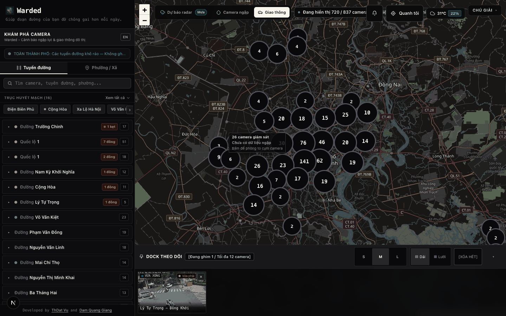
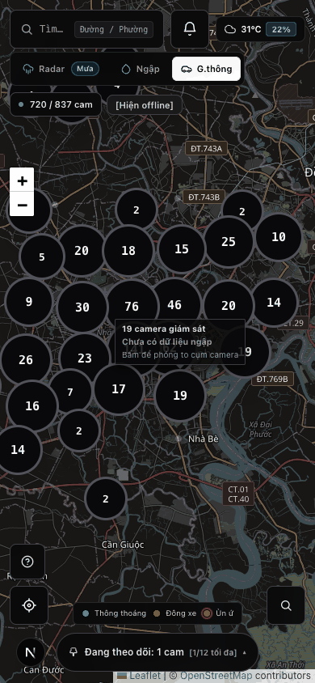
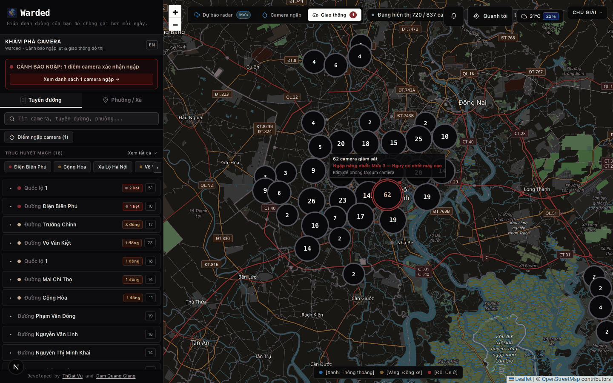
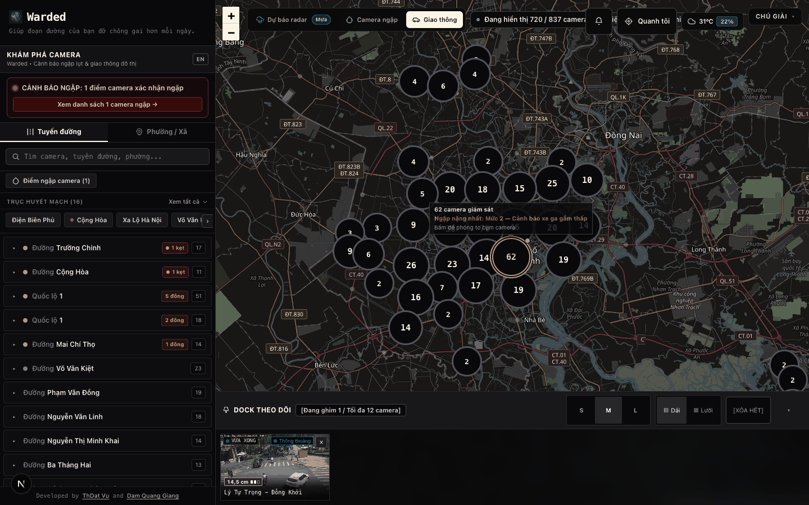
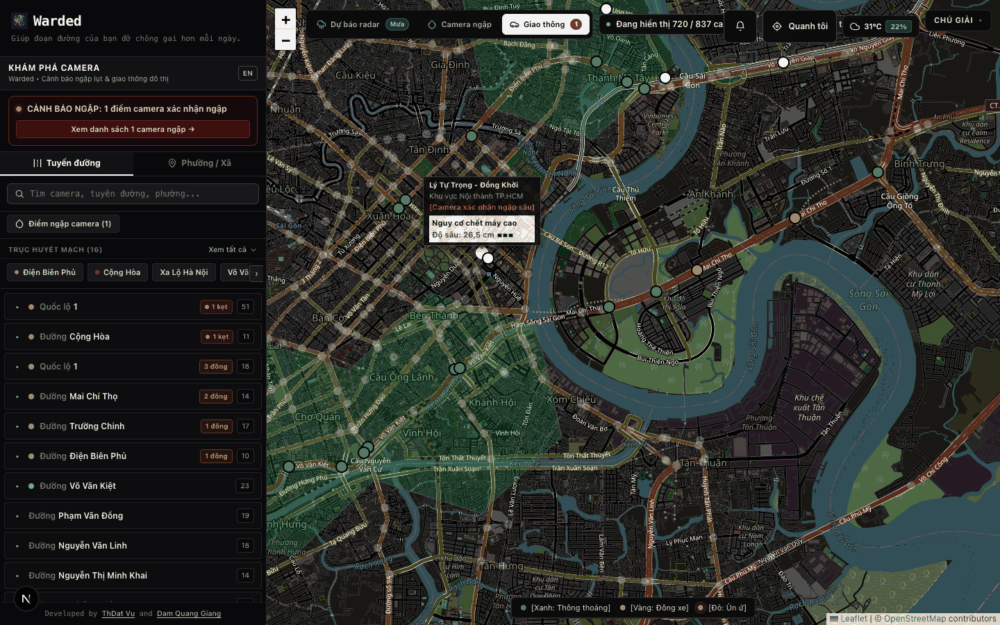
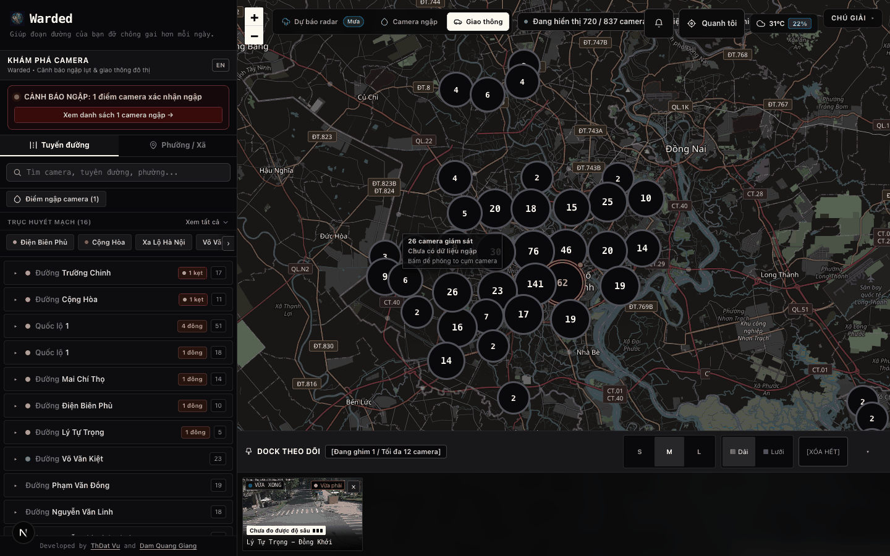
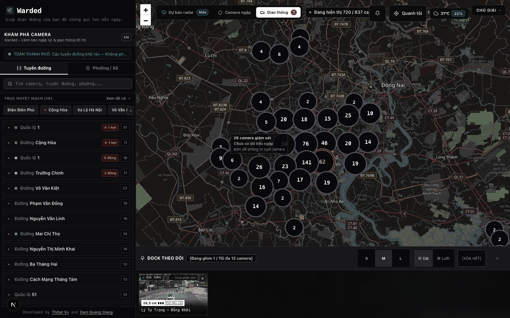
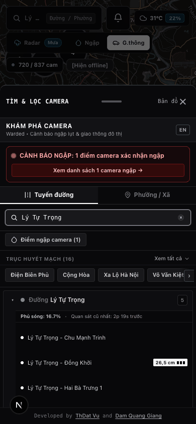
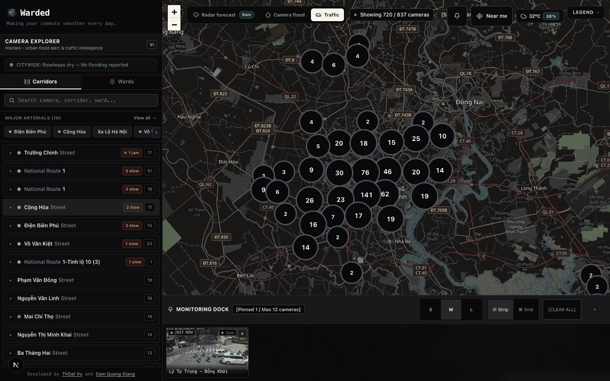

# S14-T3 Commuter Map Clustering & Hazard Depth Verification

- **Issue:** #443 (S14-T3)
- **Branch:** `feat/s14-t3-commuter-map-clustering-and-hazard-depth`
- **Date:** 2026-11-13
- **Environment:** macOS (darwin), Go toolchain in `services/go-server`, Next.js
  dev server on `:3001`, live Go backend on `:3000` with the production SQLite
  store and live camera catalog, Chromium via Playwright (1440x900 and 390x844)
- **Scope:** basemap readability, clustering below zoom 14, hazard bubble-up,
  ubiquitous depth rendering, ergonomics, i18n

This report records functional verification, not a model-quality gate. The
basemap, tile proxy, camera catalog, clustering and touch targets were exercised
against the running stack. The live verdict feed currently publishes no hazard
levels (`flood_hazard_level` is `null` for every camera), so the hazard-specific
surfaces were verified by intercepting `/api/flood-status` in the browser with
contract-shaped payloads while keeping every other request live. That
interception is labelled in every section where it appears; no artifact here is
presented as production hazard telemetry.

## 1. Implementation under test

| Area | File | Change |
|---|---|---|
| Tile proxy | `internal/tilecache/tilecache.go`, `darken.go` | Provider-namespaced cache (`osm-dark`), `MAP_TILE_UPSTREAM_URL`, optional `MAP_TILE_API_KEY`, `MAP_TILE_DARKEN`, `{s}`/`{r}` expansion, server-side dark render |
| Tile endpoint | `internal/tilecache/handler.go` | Swagger description now matches the served cartography |
| Basemap config | `apps/web/src/config/constants.ts` | `TILE_URL` through the proxy with a `?v=osm-dark-2` cache key, OSM attribution, CARTO template documented as the licensed opt-in, cluster constants, `MAP_CLUSTER_I18N` and `MAP_TOOLTIP_I18N` |
| Clustering | `apps/web/src/utils/mapClustering.ts` | Deterministic pixel-grid clustering, hazard bubble-up, forced-individual ids, badge geometry, danger-ring tokens |
| Map | `apps/web/src/components/MapComponent.tsx` | Cluster badges, cluster tooltip/click-to-zoom, regime rebuild on threshold cross, hazard depth in tooltips |
| Hazard view model | `apps/web/src/utils/hazardDisplay.ts` | One view model + Leaflet tooltip HTML for all surfaces |
| Hazard chip | `apps/web/src/components/HazardDepthChip.tsx` | Reusable depth/severity chip for dock and mobile rows |
| Dock | `apps/web/src/components/PinnedDock.tsx` | Depth chip per tile, 48 px hit areas for unpin/prev/next/header/mobile controls |
| Mobile drawer | `apps/web/src/components/MobileCameraDrawer.tsx`, `PhuongTreeFilter.tsx` | `floodVerdicts` plumbing, depth chip per camera row, 48 px rows and close |
| Hook | `apps/web/src/hooks/useFlood.ts` | Artificial 700 ms loading floor removed |
| Styling | `apps/web/tailwind.config.ts` | Scan `src/utils` and `src/config` so dynamic token classes are not purged |
| Ops | `.env.example`, `docker-compose.stg.yml`, `README.md` | Map variables documented and propagated |

## 2. Automated verification

### 2.1 Go

```
$ cd services/go-server && go test ./... -count=1
ok  .../internal/tilecache   2.700s
... all packages pass
$ go vet ./internal/tilecache/
(no output)
```

New `internal/tilecache` cases:

```
--- PASS: TestNewManagerUsesKeylessOSMAndDarkensByDefault
--- PASS: TestNewManagerHonoursUpstreamOverride
--- PASS: TestDarkenSkipsNativeDarkProviders
--- PASS: TestProviderCacheDirIsolatesProviderAndTheme
--- PASS: TestUpstreamTileURLExpandsTemplate
--- PASS: TestManagerAppendsAPIKeyWithoutLoggingIt
--- PASS: TestDarkenPNGProducesDarkHighContrastTiles
--- PASS: TestDarkenPNGRejectsNonPNG
--- PASS: TestRedactErrorNeverLeaksTheProviderKey
```

`TestDarkenPNGProducesDarkHighContrastTiles` asserts the darkened mean luma falls
below the dark threshold, black label ink is lifted above 180, and blue water
stays blue-dominant (the hue rotation preserved the semantic hue).

### 2.2 Frontend

```
$ cd apps/web && npx tsc --noEmit
(no output)
$ npm test
# tests 403
# pass 403
# fail 0
```

New suites:

- `src/utils/mapClustering.test.ts` — zoom-14 boundary, deterministic order,
  invalid coordinates dropped, hazard bubble-up (Level 3 wins, unknown is
  `null`), forced-individual cameras, degenerate bounds padding, 48 px badge
  floor, red/amber/zinc tokens, and the bilingual `MAP_CLUSTER_I18N` catalogue
  (no emoji, full VI diacritics).
- `src/utils/hazardDisplay.test.ts` — measured depth formatting (VI comma),
  zero measured vs unmeasured, avoidance-inferred Level 3 never prints
  centimetres, pre-contract verdict renders nothing, stale chip, three-segment
  meter, aria labels, tooltip HTML and escaping.

ESLint reports 0 errors; the two `` warnings are pre-existing.

### 2.3 Documentation gates

```
$ python3 tools/docs/docs_lint.py
20 violation(s), 20 in the baseline, 0 new, 0 stale
Pass: nothing new, nothing stale.
$ python3 tools/docs/check_readme_vi_parity.py
OK  8 make targets ... / all 3 ports ... / all 6 port-table rows ...
exit 0
```

`README.md` remains inside the 25,600 B on-demand ceiling (25,581 B) after the
feature and configuration updates.

## 3. Live tile proxy evidence (real upstream, real bytes)

```
$ curl -D - "http://localhost:3000/api/tiles/13/6523/3849.png"
Content-Type: image/png
X-Tile-Cache: MISS
200 142134 bytes
$ curl -D - "http://localhost:3000/api/tiles/13/6523/3849.png"
X-Tile-Cache: HIT
200 142134 bytes
bytes-identical: yes
mean_luma: 53.6 (256x256)
```

On-disk cache path: `services/go-server/data/tiles/osm-dark/13/6523/3849.png`.
An upstream failure is logged through `redactError`, which strips the provider
key (raw and URL-escaped) from `url.Error` before it reaches the log.
The stored PNG **is** the darkened asset, so the expensive pixel work happens
once per tile and every client receives dark bytes.

### 3.1 Why the CARTO default changed

Every keyless CARTO endpoint was probed before writing the proxy default:

| URL | HTTP | Mean luma | Result |
|---|:---:|---:|---|
| `https://basemaps.cartocdn.com/dark_all/12/3200/1900.png` | 200 | 40.1 | "API KEY REQUIRED" watermark |
| `https://a.basemaps.cartocdn.com/dark_all/...` | 200 | 40.1 | watermark |
| `https://a.basemaps.cartocdn.com/dark_nolabels/...` | 200 | 40.1 | watermark |
| `https://cartodb-basemaps-a.global.ssl.fastly.net/dark_all/...` | 200 | 40.1 | watermark |
| `https://a.basemaps.cartocdn.com/light_all/...` | 200 | 247.3 | watermark |
| `https://basemaps.cartocdn.com/rastertiles/voyager/...` | 200 | 247.3 | watermark |
| `https://tile.openstreetmap.org/12/3200/1900.png` | 200 | 232.8 | clean light tile |

CARTO is therefore wired as a licensed opt-in:

```
MAP_TILE_UPSTREAM_URL=https://basemaps.cartocdn.com/dark_all
MAP_TILE_API_KEY=<key from CARTO>          # appended as ?api_key=, never committed
NEXT_PUBLIC_MAP_TILE_URL=https://{s}.basemaps.cartocdn.com/dark_all/{z}/{x}/{y}{r}.png
NEXT_PUBLIC_MAP_TILE_ATTRIBUTION=...OSM contributors &copy; CARTO
```

The keyless default is OSM through the proxy, darkened server-side, with OSM
attribution only — the map never credits a provider it is not serving.

## 4. Live clustering evidence

Default city view, 1440x900, live catalog (720 visible cameras):

- 42 cluster badges on screen.
- Badge diameters 56-68 px; the smallest is above the 48 px touch floor.
- Sum of badge counts at the initial view: 709 cameras aggregated.
- Badge tooltip: `Cụm 62 camera giám sát / Chưa có dữ liệu ngập / Bấm để phóng to
  cụm camera` (live feed has no hazard levels, so the neutral state is honest).
- Clicking a badge flew to the cluster bounds: tiles switched to zoom 14 and
  `.warded-cluster` count fell to 0, i.e. every camera expanded to an individual
  marker.

Screenshots:





### 4.1 Hazard bubble-up (controlled flood-status payload)

Real camera `5deb576d1dc17d7c5515ad14` (Lý Tự Trọng - Đồng Khởi, online) was
given `flood_hazard_level: 3`, `flood_depth_cm: 26.5` through a Playwright
`page.route` interception of `/api/flood-status`. All other requests, including
the camera catalog, tiles and SSE, were live (the SSE stream was pinned only for
the mobile-capture run described in §5 to prevent a live tick from replacing the
controlled verdict).

Level 3 observed on the containing badge:

```
title: "Cụm 62 camera. Ngập nặng nhất: Mức 3 — Nguy cơ chết máy cao. Bấm để phóng to."
class: "... ring-2 ring-red-500 ring-offset-2 ring-offset-zinc-950
          bg-zinc-950 text-red-300 border-red-500 ..."
```



Level 2 on the same camera (`flood_hazard_level: 2`, `14.5 cm`):

```
title: "Cụm 62 camera. Ngập nặng nhất: Mức 2 — Cảnh báo xe ga gầm thấp. Bấm để phóng to."
class: "... ring-2 ring-amber-400 ... text-amber-200 border-amber-400 ..."
```



After clicking the badge the map reached zoom 14 and the individual marker
tooltip read:

```
Lý Tự Trọng - Đồng Khởi
Khu vực Nội thành TP.HCM
[Camera xác nhận ngập sâu]
Nguy cơ chết máy cao
Độ sâu: 26,5 cm
```

The three-segment meter renders filled to Level 3 inside the inverted (light)
hazard block.



### 4.2 Honest unmeasured state

Same camera, `flood_hazard_basis: AVOIDANCE_INFERRED`, `flood_depth_cm: null`,
Level 3. The dock chip renders the label plus `Chưa đo được độ sâu` and never a
fabricated centimetre figure:

```
title: "Nguy cơ chết máy cao · Chưa đo được độ sâu"
visible: "Chưa đo được độ sâu ▮▮▮"
```



A stale verdict renders the same chip with a `Dữ liệu cũ` chip (observed in the
first live capture after the injected timestamp aged past the 180 s TTL).

## 5. Ubiquitous depth rendering

| Surface | Evidence |
|---|---|
| Map tooltip | `Độ sâu: 26,5 cm` + three segments (§4.1) |
| Pinned dock tile | chip `26,5 cm ▮▮▮ [Dữ liệu cũ]` on the pinned camera tile |
| Mobile drawer row | chip `26,5 cm ▮▮▮` on the matching camera row at 390x844 |





## 6. Ergonomics measurements (390x844, live DOM)

| Target | Measured |
|---|---|
| Mobile search trigger | 191 x 48 |
| Mobile dock collapsed pill | 251 x 48 |
| Mobile drawer close | 72 x 48 |
| Camera row in drawer | 352 x 48 |
| Near-me control (desktop) | 107 x 48 |
| Subscribe control (desktop) | 48 x 48 |
| Cluster badge | 56-68 diameter |

Dock unpin / previous / next are 48x48 transparent hit areas around a 20 px
visual chip, so the target grows without covering the snapshot.

## 7. Manual scenario checklist (executed)

1. Load the map cold: tiles come from the Go proxy, the basemap is dark, labels
   readable, attribution reads OSM only. Pass.
2. Zoom out to city level: 42 badges, no individual smear. Pass.
3. Hover a badge: count, worst hazard, zoom hint in VI. Pass.
4. Click a badge: smooth flyToBounds, expansion at zoom >= 14. Pass.
5. Inject a Level 3 verdict: the containing badge turns red-ringed and names
   the level. Pass.
6. Inject Level 2: amber ring. Pass.
7. Inject avoidance-inferred Level 3 with no depth: chip says depth not
   measurable, no number. Pass.
8. Open a Level 3 camera marker tooltip at zoom 14: label, 26,5 cm, meter. Pass.
9. Pin the camera: dock tile shows the depth chip. Pass.
10. Mobile 390x844: clusters render, drawer search, row chip, 48 px targets. Pass.
11. Switch language VI -> EN: cluster tooltip becomes `Cluster of 20 cameras.
    No flood data. Tap to zoom in.`, legend and search copy switch, no emoji
    (see `en-clusters.png`). Ghost/duplicate tooltip lines are now bilingual.
12. Reload after a cartography change: new `?v=` key prevents stale immutable
    tiles. Pass (this was the defect that produced the first watermarked run).
13. Flood lens and ward filter: individual markers only (clustering disabled by
    design). Pass by code path and unit tests.

### 7.1 English rendering



## 8. Known limitations and follow-ups

- **Live hazard data is absent.** The production feed currently publishes
  `flood_hazard_level: null` for all cameras, so hazard visuals are verified
  against contract-shaped payloads, not production telemetry. Once S14-T1/T4
  land measured depths, re-run §4.1 without interception.
- **CARTO requires a key.** The named provider now watermarks every keyless
  style; the licensed path is implemented and documented but not exercised in
  this environment (no key available).
- **Clustering is zoom-based, not viewport-based.** At a given zoom the same
  clusters exist on a phone and a desktop. This is deterministic and keeps badge
  identity stable across rotations; a viewport-aware variant would reduce badge
  count further on small screens.
- **Server-side darkening is CPU-only work on first fetch.** Measured cache
  misses are one-time; a 256x256 tile decodes, transforms and re-encodes in
  single-digit milliseconds. If a slower target ever appears, the transform can
  be memoised per provider version (the `?v=` key already covers client caches).
