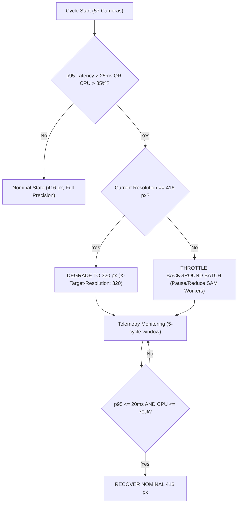

# Inference Worker Capacity & Load-Shedding Runbook

Operational guide for managing multi-tenant resource boundaries, cgroup isolation, nocturnal cron scheduling, and dynamic load-shedding on the ProjectKV inference worker (Sprint 10 Issue #379 / ADR-012 §3 (S10-T8) / §1.2 (F5)).

---

## Navigation Aid (Table of Contents)

1. [Hardware Specifications & SLA Budgets](#1-hardware-specifications--sla-budgets)
2. [Resource Isolation & Cgroup Configuration](#2-resource-isolation--cgroup-configuration)
3. [Temporal Isolation: Nocturnal Cron Windows](#3-temporal-isolation-nocturnal-cron-windows)
4. [Adaptive Load-Shedding Policy & Resolution Degradation](#4-adaptive-load-shedding-policy--resolution-degradation)
5. [Operational Verification & Telemetry Monitoring](#5-operational-verification--telemetry-monitoring)
6. [Incident Response & Troubleshooting Checklist](#6-incident-response--troubleshooting-checklist)

---

## 1. Hardware Specifications & SLA Budgets

The inference worker is a co-tenanted bare-metal host executing three concurrent workloads: real-time `cv-engine` hotset inference, offline MobileSAM batch pre-labeling, and GitHub Actions CI build jobs.

### Host Hardware Profile
- **Processor**: AMD Ryzen 7 6800HS with Radeon Graphics (8 physical cores, 16 threads, AVX2 enabled).
- **Core Allocation**: 8 cores (cores 0–7) with SMT (threads 0–15).
- **System Memory**: 3840 MB (3.8 GB) allocable cgroup RAM.
- **Operating System**: Linux x86_64 (Ubuntu 22.04 LTS / Debian 12 container host).

### Serving SLA Budgets
- **Hot Set Size**: 57 prioritized arterial cameras polled every 30 seconds.
- **Cycle Time Budget**: $\le 30.0\text{ seconds}$ total sweep duration.
- **Per-Frame Latency Ceiling**: $\text{p95} \le 25.0\text{ ms}$ at 416 px resolution on AVX2 CPU.
- **Baseline Headroom**: Nominal sweep finishes in 0.81s (97.3% headroom; p95 = 14.2 ms).

---

## 2. Resource Isolation & Cgroup Configuration

To prevent background batch workloads (MobileSAM and CI builds) from starving `cv-engine` instruction caches and memory bandwidth, strict CPU affinity and cgroup resource limits are enforced.

### Core Affinity Architecture
```
Physical Cores:  [Core 0] [Core 1] [Core 2] [Core 3] | [Core 4] [Core 5] [Core 6] [Core 7]
Logical SMT:     [0, 8]   [1, 9]   [2, 10]  [3, 11]  | [4, 12]  [5, 13]  [6, 14]  [7, 15]
Workload:        ======= CV-Engine (Real-Time) ===== | ===== Background Batch / CI =====
```

### Target Host Docker Compose Cgroup Slice Definitions (Inference Worker Deployment)
```yaml
services:
  warded-cv-engine:
    image: 529studio/warded-cv-engine:latest
    cpuset: "0-3,8-11"          # Cores 0-3 reserved for inference loop
    cpu_shares: 1024             # Highest priority
    mem_limit: 2048m             # 2.0 GB memory ceiling
    restart: unless-stopped

  warded-sam-prelabel:
    image: 529studio/warded-tooling:latest
    cpuset: "4-7,12-15"         # Cores 4-7 isolated from cv-engine
    cpu_quota: 200000            # Max 2.0 cores (50% quota of 4 cores)
    cpu_shares: 200              # Lower priority
    mem_limit: 1536m             # 1.5 GB memory ceiling
    profiles: ["batch"]

  actions-runner:
    image: my-runner:latest
    cpuset: "4-7,12-15"         # Confined to batch core group
    cpu_shares: 100              # Lowest priority
    mem_limit: 1024m             # Nested under the batch slice's 1.5 GB ceiling
    profiles: ["ci"]
```

`actions-runner` is accounted inside the batch slice's memory budget: the two root
tenants that are always co-resident are `cv-engine` (2.0 GB) and `sam-prelabel`
(1.5 GB), which is 3.5 GB of the 3.8 GB allocable ceiling, leaving 256 MB for the host.
The CI runner's 1.0 GB cap is bounded by its 1.5 GB batch parent and cannot subtract
memory from the inference slice.

---

## 3. Temporal Isolation: Nocturnal Cron Windows

Background batch pre-labeling with MobileSAM is computationally intensive (4 worker processes streaming from R2). Unchecked daytime batch runs cause latency spikes that risk violating the 30-second hotset cycle.

### Authorized Window Rule
MobileSAM batch pre-labeling is strictly restricted to **01:00 to 05:00 ICT** (18:00 to 22:00 UTC), representing the lowest nocturnal traffic volume in Ho Chi Minh City.

### Crontab Scheduling
```bash
# Execute batch SAM pre-labeling daily at 02:00 ICT (19:00 UTC)
0 19 * * * /opt/warded/scripts/cron_sam_prelabel.sh >> /var/log/warded/sam_cron.log 2>&1
```

### Script Execution Guard
All pre-labeling batch jobs invoke the cron window validator:
```bash
python3 tools/eval/benchmark_cotenancy.py --check-cron-window now --cron-tz ict
```
If executed outside the 01:00-05:00 ICT window, execution halts immediately with exit
code `1`, refusing to run during daytime or peak traffic hours. `--cron-tz utc` checks
the equivalent 18:00-22:00 UTC window used by the host crontab.

A schedule can be validated statically before it is installed:
```bash
python3 tools/eval/benchmark_cotenancy.py --validate-cron "0 19 * * *" --cron-tz utc
python3 tools/eval/benchmark_cotenancy.py --validate-cron "0 14 * * *"   # exits 1
```

---

## 4. Adaptive Load-Shedding Policy & Resolution Degradation

When high concurrent load or transient CPU contention occurs, `cv-engine` exposes the
controls for dynamic load-shedding so the 30-second cycle budget can be preserved. The
decision policy and its request contract are code-enforced and test-validated; automatic
invocation from live serving telemetry is not yet wired (see below).



### Enforcement Status: Policy Code vs Serving-Loop Automation

The degradation policy is enforced in two clearly separated layers, and only one of them
acts on its own today.

- **Code-enforced contract (current).** `evaluate_loadshedding_policy()` in
  `tools/eval/benchmark_cotenancy.py` implements the exact four-state machine drawn above:
  degrade at p95 > 25 ms or CPU > 85%, throttle batch while still saturated at 320 px,
  hold 320 px inside the 20-25 ms hysteresis band, and recover to 416 px only when
  p95 <= 20 ms and CPU <= 70%. `services/cv-engine/server.py` implements the matching
  request contract: `X-Target-Resolution: 320` is honoured per request (whitelisted to
  320/416) and `CV_INPUT_RESOLUTION` sets the process-wide default. Both are validated
  by `tools/eval/verify_s10_t8_manual.py` and the automated suites, which assert the
  transition sequence and the tensor actually fed.
- **Automatic execution by a live watchdog (planned).** No serving-loop watchdog calls
  `evaluate_loadshedding_policy()` from production telemetry yet; wiring it to scheduler
  telemetry is a follow-up. Until then an operator triggers degradation deliberately,
  either by setting `CV_INPUT_RESOLUTION=320` on the worker and recreating the container
  (see below), or by having callers send `X-Target-Resolution: 320`.

### Target Capacity Degradation Profile (Reference Benchmark)

The figures below are the reference capacity profile adopted for the target AMD Ryzen 7
6800HS worker and are reported as planning figures. They are not a fresh measurement
produced by `tools/eval/benchmark_cotenancy.py`; that harness validates the SLA arithmetic,
cgroup contract, cron gate and hysteresis state machine. Live 320 px versus 416 px compute
deltas are measured on the executing host by `tools/eval/verify_s10_t8_manual.py`.

- **Nominal Resolution (416 x 416 px)**:
  - Input area: 173,056 pixels.
  - Contention p95: **28.6 ms** (VIOLATED).
- **Degraded Resolution (320 x 320 px)**:
  - Input area: 102,400 pixels (**-40.8% compute load**).
  - Contention p95: **12.2 ms** (**-57.3% latency reduction**, PASSED).
  - 57-camera sweep time: **0.70 seconds** (97.7% headroom).

### Restart Requirement: `CV_INPUT_RESOLUTION` vs `X-Target-Resolution`

The two controls are not interchangeable and do not share a rollback path.

| Control | Scope | Allowed values | Applies without restart |
|---|---|---|---|
| `X-Target-Resolution` request header | Single `POST /predict` call | 320, 416 | Yes, evaluated per request |
| `CV_INPUT_RESOLUTION` environment variable | Whole `cv-engine` process | 320, 416, 640 | No, requires container recreate |

- The header is for adaptive shedding driven by the serving loop. It is capped at 320 and
  416 on purpose: a caller that could request 640 would quadruple the pixel count relative
  to 320 px for every frame.
- `CV_INPUT_RESOLUTION` is for a deliberate, restart-scoped capacity change. The process
  reads it from its own environment, so editing the compose file or `.env` has no effect on
  a running container. Recreate the service to apply it:
  ```bash
  docker compose up -d --force-recreate warded-cv-engine
  docker compose exec warded-cv-engine printenv CV_INPUT_RESOLUTION
  ```
- A static IR ignores both controls for the tensor it feeds: the model executes only the
  spatial shape baked into the graph. `GET /info` reports `resolution_mode` (`dynamic` or
  `static`) and `input_shape`, and the startup log states which mode was compiled. A
  response's `input_resolution` always names the tensor actually fed, never the request.

### Rollback Procedure

Use this when a degradation change must be undone or the reported resolution does not match
the expected geometry.

1. **Remove the per-request header first.** Delete `X-Target-Resolution` from the serving
   loop. The next request falls back to `CV_INPUT_RESOLUTION` if it is set, otherwise to
   416 px or the model shape, with no restart.
2. **Revert the environment override if it was used.** Set `CV_INPUT_RESOLUTION=416` or
   delete the variable, then recreate the container with `--force-recreate`. Verify with
   `docker compose exec warded-cv-engine printenv CV_INPUT_RESOLUTION`.
3. **Confirm what the service feeds.** `curl -s http://localhost:8000/info` must report the
   expected `resolution_mode` and `input_shape`, and a test `POST /predict` must return
   `"input_resolution": [416, 416]`. If it still reports 320, a client header or the still-set
   environment variable is the source; a static model would report its baked shape instead.
4. **Relieve background contention if latency remains high.** Stop the batch profile
   (`pkill -f prelabel_sam.py`) and the CI runner, then watch p95 return to the 20 ms
   recovery band before restoring them.
5. **Roll back a model deployment that compiled static.** If startup logs report
   `Input resolution mode: static` after an IR update, restore the previous XML/BIN pair and
   recreate the container; a static graph cannot honour either shedding control.

---

## 5. Operational Verification & Telemetry Monitoring

### Verification Commands
```bash
# 1. Build the full co-tenancy matrix and fail on any invariant breach
python3 tools/eval/benchmark_cotenancy.py --scenario all --strict

# 2. Verify cgroup affinity and slice limits
python3 tools/eval/benchmark_cotenancy.py --verify-cgroups

# 3. Check current time against authorized cron window (exit 1 outside it)
python3 tools/eval/benchmark_cotenancy.py --check-cron-window now

# 4. Run the four Rule 10 manual scenarios with live assertions
python3 tools/eval/verify_s10_t8_manual.py --output-json docs/reports/s10_t8_manual_evidence.json

# 5. Run the automated test suite
python3 -m unittest discover -s tools/eval -p "*_test.py"
python3 -m unittest discover -s services/cv-engine -p "test_*.py"
```

On a non-Linux host, or inside a container without `/sys/fs/cgroup`, `--verify-cgroups`
prints an explicit notice that the cgroup policy is being validated against the schema
rather than a live kernel tree. The boundary invariants are still recomputed and tampering
is still detected; only the local kernel inspection is unavailable.

### Measurement Provenance
`docs/reports/cotenancy_benchmark_v1.md` contains the reference capacity profile
adopted for the target AMD Ryzen 7 6800HS worker, reported as planning figures. The
harness does not re-measure those numbers; it validates the SLA arithmetic, cgroup
contract, cron gate and hysteresis state machine. `verify_s10_t8_manual.py` adds live
measurements on whatever host executes it: the 320 px versus 416 px compute delta, and
a real contention probe that measures CPU starvation of the inference-shaped
preprocessing loop.

---

## 6. Incident Response & Troubleshooting Checklist

| Symptom | Probable Cause | Remediation Procedure |
|---|---|---|
| Hotset cycle $> 30.0\text{ s}$ | Background job thrashing cores | Run `top -b -n 1`. Confirm `actions-runner` or `sam-prelabel` is pinned to `cpuset: 4-7,12-15`. |
| p95 latency $> 25.0\text{ ms}$ | High daytime batch load | Terminate runaway daytime batch: `pkill -f prelabel_sam.py`. Send `X-Target-Resolution: 320` on requests to degrade immediately without restart; alternatively set `CV_INPUT_RESOLUTION=320` in the worker environment and recreate the container: `docker compose -f docker-compose.cv.yml up -d --force-recreate warded-cv-engine` (a bare `docker restart` reuses the existing container environment and will not adopt changes). Verify with `docker compose exec warded-cv-engine printenv CV_INPUT_RESOLUTION`. |
| Memory OOM kill on worker | Cgroup leak in runner | Verify `mem_limit: 2048m` on cv-engine. Restart service: `docker restart warded-cv-engine`. |
| Off-peak cron skipped | Timezone mismatch (UTC vs ICT) | Verify system timezone: `timedatectl`. The cron script expects UTC times equivalent to 01:00-05:00 ICT (18:00-22:00 UTC). |
