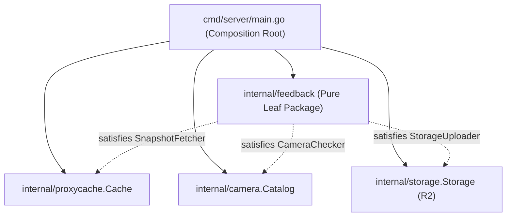

# S7-T4 / S8-T2: internal/feedback Leaf Package & Cloudflare R2 Archiver Implementation Plan

> **Tracking:** Issue [#249](https://github.com/529-studio/projectKV/issues/249), Kanban **[KV-3]**  
> **Epic:** `epic:flood-integrity`  
> **Scope:** `services/go-server/internal/feedback/`, `services/go-server/cmd/server/main.go`, `docs/`  
> **Rule 3 Estimation:** Active Effort: **10 hours (1.5 working days)** | Expected Delivery: **1.5 calendar days** (within current session)

---

## 1. Context & Objectives

In Sprint 7 Wave 1 (S7-T3 / PR #259), the frontend added the tactile action button `[Báo cáo ngập tại đây]` in `CameraModal.tsx` (`POST /api/v1/cameras/:id/report-flood`), protected by a 30-second client-side cooldown.

However, the Go backend has not implemented this endpoint yet. When commuters report flooding, the backend must:
1. Validate the camera ID exists in the catalog.
2. Enforce a strict in-memory rate limit: **max 1 report per client IP per camera per 5 minutes** to prevent malicious or accidental spam, returning HTTP 429 when throttled.
3. Immediately acknowledge the commuter request (HTTP 200).
4. Asynchronously fetch the live camera frame from `proxycache` (or upstream), generate an immutable ISO 8601 manifest with SHA-256 hashed client IP (`trust: "unverified"`, `source: "user_reported"`), and stream both the JPEG snapshot and JSON manifest to Cloudflare R2 under `feedback/<YYYY-MM-DD>/<camera_id>_<unix_ts>.jpg` and `.json`.
5. Maintain strict **Leaf Modulith** compliance (`internal/feedback/` has zero imports of sibling packages under `internal/`).

---

## 2. Architecture & File Decomposition

```
services/go-server/
├── internal/
│   └── feedback/
│       ├── types.go           # DTOs, manifest schema, and consumer interfaces (SnapshotFetcher, CameraChecker, StorageUploader)
│       ├── limiter.go         # Thread-safe in-memory sliding rate limiter (5m cooldown per IP:Camera) with auto-pruning
│       ├── archiver.go        # Asynchronous frame capture, SHA-256 IP hashing, manifest generation, and R2 uploader
│       ├── handler.go         # Gin HTTP route handlers for POST /api/v1/cameras/:id/report-flood with Swagger annotations
│       └── feedback_test.go   # Comprehensive concurrent race tests, rate limit boundary tests, and mock end-to-end tests
└── cmd/server/
    └── main.go                # Composition root: wires proxyCache/upstream fetcher, camera checker, and R2 driver
```

### Dependency Inversion & Modulith Boundaries


`internal/feedback/` imports **only standard library** (`context`, `crypto/sha256`, `encoding/json`, `fmt`, `io`, `log/slog`, `net/http`, `sync`, `time`) and `github.com/gin-gonic/gin`. **Zero sibling imports**.

---

## 3. Detailed Technical Specifications

### 3.1. Rate Limiter (`limiter.go`)
- **Key**: `fmt.Sprintf("%s:%s", clientIP, cameraID)`
- **Duration**: `5 * time.Minute`
- **Concurrency**: Thread-safe with `sync.RWMutex` (or `sync.Map`).
- **Methods**:
  - `Allow(clientIP, cameraID string) (allowed bool, retryAfter time.Duration)`
  - `Prune(olderThan time.Duration)`
- **HTTP 429 Response Payload**:
  ```json
  {
    "error": "rate_limited",
    "message": "Too many reports for this camera. Please try again later.",
    "retry_after_seconds": 240
  }
  ```

### 3.2. Asynchronous Archiving & Manifest Schema (`archiver.go`)
- **Storage Paths**:
  - Image: `feedback/YYYY-MM-DD/<camera_id>_<unix_ts>.jpg`
  - Metadata: `feedback/YYYY-MM-DD/<camera_id>_<unix_ts>.json`
- **Metadata JSON Schema**:
  ```json
  {
    "source": "user_reported",
    "trust": "unverified",
    "camera_id": "586e2995f9fab7001111b0b5",
    "timestamp": "2026-10-17T13:45:00Z",
    "client_ip_hash": "a1b2c3d4...",
    "user_agent": "Mozilla/5.0 ...",
    "has_snapshot": true
  }
  ```
- **Privacy Assurance**: Client IP is hashed using SHA-256: `fmt.Sprintf("%x", sha256.Sum256([]byte(clientIP)))`. Raw IP addresses are **never written** to persistent storage or logs.

### 3.3. HTTP Routes & Swagger (`handler.go`)
- Mounted under Gin router:
  - `POST /api/v1/cameras/:id/report-flood`
  - `POST /api/cameras/:id/report-flood` (alias for backward compatibility)
- Swagger Annotations:
  ```go
  // @Summary Report road flooding at camera location
  // @Description Accepts crowd-sourced flood observation, enforces 5-minute per-IP rate limit, and asynchronously archives snapshot to Cloudflare R2
  // @Tags feedback
  // @Produce json
  // @Param id path string true "Camera ID"
  // @Success 200 {object} ReportResponse
  // @Failure 400 {object} map[string]string
  // @Failure 404 {object} map[string]string
  // @Failure 429 {object} map[string]string
  // @Router /v1/cameras/{id}/report-flood [post]
  ```

---

## 4. Implementation Steps & TDD Workflow

### Phase 1: Branch Creation & Modulith Scaffolding
- [ ] Create branch `feat/s7-t4-feedback-r2-archiver` from `dev`.
- [ ] Define interfaces and data structs in `services/go-server/internal/feedback/types.go`.

### Phase 2: Test-Driven Rate Limiter (`limiter.go` & `feedback_test.go`)
- [ ] Write unit tests for `RateLimiter`:
  - First request allows.
  - Second request within 5m rejects with `retryAfter > 0`.
  - Same IP on different camera allows.
  - Different IP on same camera allows.
  - Expired entries allow after 5m.
  - Concurrent simulation under 50 parallel goroutines with zero data races.
- [ ] Implement `RateLimiter` in `limiter.go`. Verify tests pass with `go test -race ./internal/feedback/...`.

### Phase 3: Archiver & Handler Implementation
- [ ] Implement `archiver.go`:
  - `ArchiveReport(ctx context.Context, cameraID, clientIP, userAgent string, ts time.Time)`
  - Snapshot fetch from `SnapshotFetcher`.
  - JSON metadata serialization with SHA-256 IP hash.
  - Asynchronous background worker dispatch.
- [ ] Implement `handler.go`:
  - `ReportFlood(c *gin.Context)`
  - Parameter validation (`:id`).
  - `CameraChecker.CameraExists(id)` validation -> HTTP 404 if unknown.
  - Rate limit evaluation -> HTTP 429 if throttled.
  - Return HTTP 200 `{ "status": "success", "message": "Ghi nhận phản ánh ngập thành công", ... }`.
  - `RegisterRoutes(rg *gin.RouterGroup)`.
- [ ] Write handler unit tests with Gin engine (`httptest.NewRecorder`).

### Phase 4: Composition Root Wiring & Swagger Sync
- [ ] In `services/go-server/cmd/server/main.go`:
  - Create adapters for `SnapshotFetcher` and `CameraChecker`.
  - Wire `feedback.NewHandler(fetcher, checker, storeDriver, limiter)`.
  - Mount routes on `api := router.Group("/api")`.
- [ ] Run `make swagger` in `services/go-server/` to regenerate `docs/docs.go`, `docs/swagger.json`, `docs/swagger.yaml`.

### Phase 5: Verification & Governance Audit
- [ ] Run `architecture-guardian` skill checks:
  - Verify zero internal sibling imports in `internal/feedback/`.
  - Verify `gofmt -l .` and `go vet ./...` clean.
- [ ] Run test suites:
  - `go test -race ./...` (all 25 Go packages pass).
  - `npm test --prefix apps/web` (151 web tests pass).
  - `npm run build --prefix apps/web` (Next.js production build clean).
- [ ] Live End-to-End simulation with `curl`:
  - Verify `curl -X POST http://localhost:3000/api/v1/cameras/<id>/report-flood` returns 200.
  - Immediate repeat returns 429.
  - Invalid camera ID returns 404.
- [ ] Update Living Documentation:
  - Add Lesson 45 to `docs/lesson_learn.md`.
  - Update `docs/project_status.md`.
  - Update `docs/sprint7_execution_guide.md` / `docs/sprint7_report.md`.
- [ ] Commit and open PR targeting `dev`:
  - Title: `feat(go-server): internal/feedback leaf package and Cloudflare R2 crowd archiver`
  - Body start: `Close #249 closes [KV-3]`.
