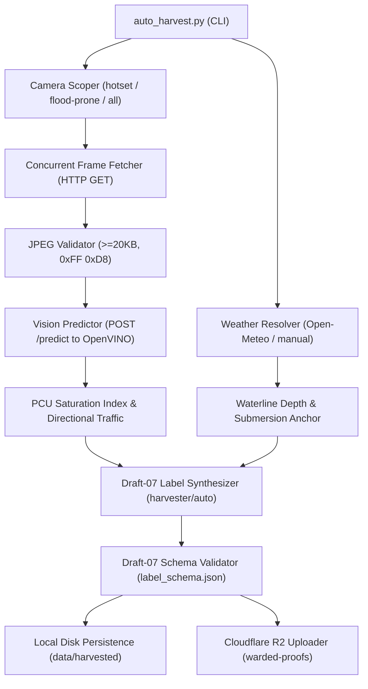

# S7-T7c: Standalone Automated Harvester CLI (`tools/eval/auto_harvest.py`) Implementation Plan

> **Tracking:** Issue [#263](https://github.com/529-studio/projectKV/issues/263), Kanban **[KV-11]**  
> **Epic:** `epic:eval-tooling`  
> **Scope:** `tools/eval/auto_harvest.py`, `tools/eval/auto_harvest_test.py`, `docs/`  
> **Rule 3 Estimation:** Active Effort: **8 hours (1 working day)** | Expected Delivery: **1 calendar day** (within current session)

---

## 1. Context & Objectives

In Sprint 7 (PR #268 / S7-T7b), the Go backend gained `internal/harvester`, an autonomous background worker running 24/7 on staging/production that ingests camera frames at scheduled peak hours (07:30, 12:00, 17:30 ICT) and during rain events ($\text{rain} \ge 0.10\text{ mm/h}$), generates Draft-07 pseudo-labels, and uploads them to Cloudflare R2 bucket `warded-proofs`.

However, evaluators, data engineers, and CI jobs frequently need to execute this autonomous data flywheel **on demand, offline, or via local crontab** without booting the full Go server stack.

**Issue #263 (S7-T7c)** delivers a standalone, modular Python CLI: `tools/eval/auto_harvest.py`.

---

## 2. Architecture & File Decomposition

```
tools/eval/
├── auto_harvest.py          # Standalone CLI: arg parser, weather fetcher, camera scoping, CV inference, Draft-07 label synthesis, R2 uploader
└── auto_harvest_test.py     # Unit test suite: arg parsing, scope resolution, weather fallback, label synthesis, Draft-07 validation
```

### Component Flow


---

## 3. Detailed Specifications

### 3.1. CLI Arguments & Defaults
- `--trigger {scheduled,rain,now}`: Trigger mode (default: `now`).
  - When `scheduled` or `now`, default scope is `hotset`.
  - When `rain`, default scope is `flood-prone`.
- `--scope {hotset,flood-prone,all}`: Target camera set (default: None, inferred from `--trigger`).
- `--weather {auto,dry,rain,heavy_rain}`: Weather condition (default: `auto`).
  - `auto`: Queries Open-Meteo API (`latitude=10.762622, longitude=106.660172`). If rainfall $\ge 5.0\text{ mm}$, maps to `heavy_rain`; if $\ge 0.10\text{ mm}$ or rain WMO codes, maps to `rain`; else `dry`. Falls back to `dry` upon network error.
- `--cv-engine-url`: URL of OpenVINO inference service (default: `os.getenv("CV_ENGINE_URL", "http://localhost:8000")`).
- `--upload-r2`: Synchronize harvested frames and JSON manifests to Cloudflare R2 bucket `warded-proofs` using credentials dynamically loaded from `.env` via `load_dotenv()` (Rule 8: zero hardcoded secrets).
- `--validate`: Strict in-memory validation against `tools/eval/label_schema.json` before saving or uploading.
- `--dry-run`: Display target cameras, weather status, and execution plan without making network requests or saving files.
- `--limit <N>`: Maximum number of cameras to process (useful for smoke tests).
- `--output-dir <DIR>`: Output directory for local files (default: `./data/harvested`).
- `--concurrency <N>`: Worker thread concurrency (default: 10).

### 3.2. Camera Scoping
- `hotset`: 57 arterial intersection cameras (`cameras_enriched.json` matching `len(road_keys) == 2` or curated Hot Set corridors: `vo_van_kiet`, `mai_chi_tho`, `dien_bien_phu`, `cong_hoa`).
- `flood-prone`: Cameras in `tools/eval/fixtures/flood_chokepoints.json` and cameras along known shallow flood corridors (`ung_van_khiem`, `nguyen_xi`, `tran_xuan_soan`, `huynh_tan_phat`, etc.).
- `all`: All online cameras (`isOnline: true` or `status: "UP"`).

### 3.3. Draft-07 Label Schema Compliance
Auto-generated manifest strictly conforms to `tools/eval/label_schema.json`:
- `frame_id`: `<camera_id>_<unix_ts>`
- `camera_id`: hex ID
- `camera_name`: location name
- `image_path`: `feedback/<YYYY-MM-DD>/<camera_id>_<unix_ts>_sample.jpg` (or local path)
- `annotator`: `"harvester/auto"` (provenance tag required by Web Labeler filter S7-T7d)
- `annotated_at`: ISO-8601 formatted string
- `labels`:
  - `traffic`: `CLEAR` | `MODERATE` | `HEAVY` | `CONGESTED`
  - `traffic_dir_a`: directional traffic Level of Service
  - `traffic_dir_b`: directional traffic Level of Service
  - `carriageway_direction`: `"bidirectional"` (or `"inbound"` / `"outbound"`)
  - `is_waiting_red_light`: boolean
  - `queue_reason`: `"free_flow"` | `"bottleneck"`
  - `flood`: `NONE` | `SHALLOW` | `DEEP`
  - `waterline_depth`: `DRY` | `WET_SURFACE` | `TIRE_QUARTER_SUBMERGED`
  - `flood_submersion_anchor`: `dry` | `wet_asphalt_no_standing` | `tire_base_under_10cm`
  - `time_of_day`: `day` | `night` | `dawn_dusk` (based on ICT hour)
  - `weather`: `dry` | `rain` | `heavy_rain`
  - `quality_tags`: array of optical distortion flags

---

## 4. Implementation Steps

1. **Branch Setup**:
   - Create branch `tooling/s7-t7c-auto-harvest-cli` from latest `dev` (`f9d1a3f`).
2. **CLI Implementation (`tools/eval/auto_harvest.py`)**:
   - `load_dotenv()` for dynamic environment secret loading.
   - `fetch_weather(url, timeout)` with Open-Meteo parsing and graceful fallback.
   - `load_catalog()` and `filter_cameras(catalog, scope)`.
   - `is_valid_jpeg(data)`.
   - `detect_vehicles(image_bytes, cv_engine_url)` calling `/predict`.
   - `calculate_traffic(counts, base_capacity)` for PCU Saturation Index.
   - `synthesize_label(camera, img_bytes, weather, pred_res, ts)` returning Draft-07 dict.
   - `validate_label(data, schema)` wrapping `validate_labels.py`.
   - `upload_to_r2(s3_client, bucket, key, data, content_type)`.
   - Worker thread pool for concurrent camera harvesting.
3. **Unit Tests (`tools/eval/auto_harvest_test.py`)**:
   - `test_arg_parser_defaults`: default scope based on trigger.
   - `test_filter_cameras`: hotset, flood-prone, all scopes.
   - `test_weather_mapping`: Open-Meteo code & rain mm mapping.
   - `test_jpeg_validator`: valid vs truncated vs non-JPEG.
   - `test_label_synthesis`: verifies all required fields, enums, and Draft-07 schema compliance.
   - `test_dry_run`: confirms zero network calls and zero file writes in dry-run mode.
4. **End-to-End Verification**:
   - Run `python3 -m unittest tools/eval/auto_harvest_test.py`.
   - Run live command: `python3 tools/eval/auto_harvest.py --scope hotset --weather dry --dry-run`.
5. **Living Documentation & Governance**:
   - Add Lesson 46 in `docs/lesson_learn.md`.
   - Update `docs/project_status.md`, `docs/sprint7_execution_guide.md`, `docs/sprint7_report.md`.
6. **PR Creation**:
   - Commit, push, and open PR targeting `dev`:
     `Close #263 closes [KV-11]`.
