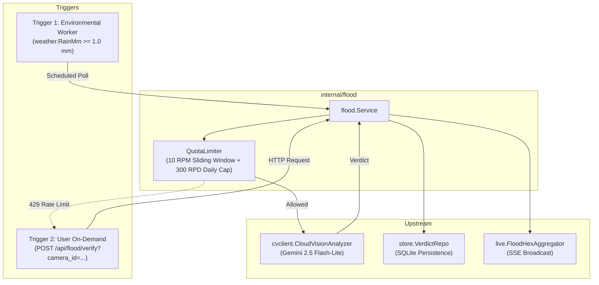

# Technical Design Specification: Decoupled Hybrid Multimodal Flood Pipeline (S5-T3 / Issue #209)

**Document Version:** 1.0.0  
**Date:** 2026-10-11  
**Author:** Warded Architecture Team  
**Status:** In Review  
**Tracking Issues:** [#209](https://github.com/529-studio/projectKV/issues/209)  
**References:**
- [`docs/ADR-006-sprint4-audit-and-sprint5-plan.md`](../ADR-006-sprint4-audit-and-sprint5-plan.md) Finding 3
- [`docs/decision-openvino-vs-vlm.md`](../decision-openvino-vs-vlm.md) Option C
- [`tools/eval/fixtures/smoke_test_cameras.json`](../../tools/eval/fixtures/smoke_test_cameras.json)

---

## 1. Problem Statement & Background

During Sprint 4 T9 and Sprint 5 T1/T2 audits, two architectural gaps were exposed in the flood perception pipeline:
1. **Perception Separation**: Stock YOLOv8n object detection operates solely on bounding boxes for 80 COCO objects and has 0% flood recall (120/120 missed flood frames in the D6 real dataset evaluation). Continuous automated traffic polling on the 57 hotset cameras must remain on self-hosted OpenVINO, but flood detection requires multimodal visual-language reasoning (Gemini Flash-Lite VLM).
2. **Fictitious Placeholders & Divergent Thresholds (ADR-006 Finding 3)**:
   - Previous documentation cited "10 known flood chokepoints" which was a fabricated reference conflated with the 10 traffic-only smoke cameras.
   - The rainfall trigger in `decision-openvino-vs-vlm.md` cited a 2.0 mm/h heuristic, whereas the web client in `apps/web/src/utils/rainHexUtils.ts` operates on 1.0/4.0/15.0 mm thresholds.
   - Free-tier API quotas (15 RPM / 500 RPD) require strict programmatic enforcement to guarantee zero cost without human intervention.

This specification details the technical design of the decoupled hybrid flood pipeline, introducing authentic municipal flood chokepoints, a dual-trigger VLM dispatch mechanism in `services/go-server`, strict rate/quota limiters, and an interactive verification badge in `apps/web`.

---

## 2. Authentic Municipal Flood Hotspots

The fixture `tools/eval/fixtures/flood_chokepoints.json` curates exactly 10 authentic chronic inundation points documented by the Ho Chi Minh City Department of Construction (Sở Xây dựng TP.HCM) and the Technical Infrastructure Management Center (Trung tâm Quản lý Hạ tầng Kỹ thuật - UDI), mapped directly to online, non-ghost cameras in `cameras_enriched.json`:

| Index | Camera ID | Camera Name | District | Flood Mechanism | Citation Source |
|:---:|---|---|---|---|---|
| 1 | `586e2995f9fab7001111b0b5` | Ung Văn Khiêm - Nguyễn Gia Trí (D2) | Bình Thạnh | Tidal + Rain | UDI HCMC Annual Inundation Report |
| 2 | `66b1c3fa779f740018674146` | Nguyễn Hữu Cảnh - Ung Văn Khiêm | Bình Thạnh | Rain / Low-lying basin | Sở Xây dựng TP.HCM Flood Prevention Bulletin |
| 3 | `5a8254b05058170011f6eac3` | Xô Viết Nghệ Tĩnh - Nguyễn Xí 1 (Cầu Đỏ) | Bình Thạnh | Tidal + Rain | UDI HCMC Flood Monitoring Map |
| 4 | `63bd1f21bfd3d90017ec3d04` | Huỳnh Tấn Phát - Phạm Hữu Lầu | District 7 | Tidal inundation corridor | Sở Xây dựng TP.HCM Southern Flood Bulletin |
| 5 | `662a88521afb9c00172d2592` | Kinh Dương Vương - Hồ Học Lãm | Bình Tân | Compound tidal / runoff basin | UDI Western Gateway Inundation Audit |
| 6 | `6623f4df6f998a001b2528eb` | Quốc Lộ 13 - Cầu Ông Dầu | TP Thủ Đức | Heavy rain depression | Sở Xây dựng TP.HCM Northern Arterial Report |
| 7 | `5d8cd98d766c88001718895a` | Phạm Văn Đồng - Tô Ngọc Vân | TP Thủ Đức | Flash runoff / localized depression | Thủ Đức City Flood Management Register |
| 8 | `662b55111afb9c00172d8e2e` | Quang Trung - Phạm Văn Chiêu | Gò Vấp | Localized basin runoff | Gò Vấp District Drainage Infrastructure Report |
| 9 | `662b52a31afb9c00172d8b01` | Lê Đức Thọ - Hẻm 688 | Gò Vấp | Rainwater accumulation | UDI Gò Vấp Drainage Bulletin |
| 10 | `587c782db807da0011e33d3b` | Võ Nguyên Giáp - Thảo Điền | TP Thủ Đức | Tidal / Riverbank overflow | UDI Thảo Điền Urban Drainage Monitor |

*Constraint*: None of these cameras overlap with the 10 traffic smoke-test cameras in `smoke_test_cameras.json`.

---

## 3. Domain Threshold Reconciliation

The rainfall thresholds are unified across frontend and backend:
- **`RainMm >= 1.0` (or active rain WMO codes 51-67, 80-82, 95-99)**: The empirical threshold of wet pavement and active precipitation onset in Ho Chi Minh City. This triggers `WET` classification in `rainHexUtils.ts` and acts as the environmental activation barrier for Trigger 1 in the Go backend.
- **`RainMm >= 4.0`**: Shallow water accumulation risk (`FLOODED_SHALLOW`).
- **`RainMm >= 15.0`**: Severe torrential rain / deep water accumulation risk (`FLOODED_DEEP`).

The documentation discrepancies in `docs/decision-openvino-vs-vlm.md` are formally corrected:
1. Replace the "10 known flood chokepoints" conflation with explicit reference to `tools/eval/fixtures/flood_chokepoints.json`.
2. Qualify the "$0 cost" claim for `dev-box` as API/SaaS cost only, disclosing physical homelab electricity, network bandwidth, and hardware wear.
3. Align the 2.0 mm/h heuristic to the 1.0 mm empirical wet road onset threshold.

---

## 4. Backend Dual-Trigger VLM Subsystem (`services/go-server/internal/flood`)

### 4.1 Architecture & Component Boundaries



### 4.2 Rate & Quota Limiter (`limiter.go`)
- **10 RPM Sliding Window**: Stores timestamps of successful acquisitions within the last 60 seconds; requests exceeding 10 are rejected with `ErrRateLimited`.
- **300 RPD Daily Quota**: An atomic/mutex-guarded counter tracking total calls since 00:00:00 UTC. Requests exceeding 300 are rejected with `ErrDailyQuotaExceeded`.
- **Concurrency**: Guaranteed safe under high concurrent requests via `sync.Mutex`.

### 4.3 Trigger 1: Environmental Rain Event Routine
- Runs on a configurable ticker (default: 60s).
- Calls `weatherService.GetWeather(ctx)`.
- If `weather.RainMm < 1.0` and no rain WMO code is present: stays completely idle (**0 VLM calls**).
- If `weather.RainMm >= 1.0` or active rain code: iterates sequentially through the 10 flood chokepoints, acquiring a slot from `QuotaLimiter` and analyzing the snapshot. Successful verdicts are forwarded to `onVerdict` (persisting to SQLite and broadcasting via SSE).

### 4.4 Trigger 2: On-Demand Modal Verification API
- Endpoint: `POST /api/flood/verify?camera_id=:id`
- Parameters: `camera_id` (query parameter or body)
- Returns:
  ```json
  {
    "camera_id": "586e2995f9fab7001111b0b5",
    "camera_name": "Ung Văn Khiêm - Nguyễn Gia Trí (D2)",
    "flood_severity": "WET",
    "confidence": 0.88,
    "description": "Wet asphalt with minor surface puddles; traffic moving normally.",
    "source": "vlm",
    "verified_at": "2026-10-11T05:30:00Z",
    "quota_remaining_minute": 9,
    "quota_remaining_day": 294
  }
  ```
- Error Responses:
  - `400 Bad Request`: Missing or invalid `camera_id`.
  - `404 Not Found`: Camera not found in catalog.
  - `429 Too Many Requests`: Rate limit (10 RPM) or daily quota (300 RPD) reached.
  - `503 Service Unavailable`: Snapshot fetch failed or Gemini upstream error.

---

## 5. Web Client Modal UI (`apps/web/src/components/CameraModal.tsx`)

1. **Verify Flood Action Button**:
   - Monochromatic, minimalist button in the modal toolbar: `[XÁC MINH NGẬP NƯỚC]` / `[VERIFY FLOOD]`.
   - Disabled with a spinner during in-flight verification (`[ĐANG XÁC MINH VLM...]` / `[VERIFYING WITH VLM...]`).
2. **Multimodal Verification Badge**:
   - When verified verdict is returned:
     - `DRY` -> `[XÁC MINH VLM: KHÔ RÁO]` (neutral zinc border)
     - `WET` -> `[XÁC MINH VLM: ĐƯỜNG ƯỚT]` (subtle sky border)
     - `FLOODED_SHALLOW` -> `[XÁC MINH VLM: NGẬP NÔNG]` (amber border)
     - `FLOODED_DEEP` -> `[XÁC MINH VLM: NGẬP SÂU]` (rose border)
   - Displays confidence percentage and one-sentence English description.
3. **Graceful Rate-Limit Notification**:
   - If HTTP 429 is encountered, displays a clean inline notification: `[ĐÃ ĐẠT GIỚI HẠN 10 RPM / 300 RPD]` without crashing or disturbing video playback.

---

## 6. Verification & Operational Testing Plan

1. **Unit & Race Tests**:
   - `go test -v -race ./internal/flood/...`
   - Test 10 RPM boundary condition (fire 15 concurrent goroutines; assert exactly 10 succeed, 5 fail with 429).
   - Test daily quota reset on day rollover.
   - Test environmental trigger dry-weather zero-call assertion.
2. **Web Tests**:
   - `npm run test` and `npm run lint` in `apps/web`.
3. **Swagger Generation**:
   - `make swagger` in `services/go-server`.
4. **Live Operational Simulation (Rule 4)**:
   - Run local backend with `ANALYZER=mock` or `ANALYZER=vlm`.
   - Test `GET /api/flood/chokepoints`.
   - Test `POST /api/flood/verify?camera_id=...`.
   - Fire 12 requests in rapid succession to verify 429 throttling.
   - Verify weather-triggered background routine logs.
