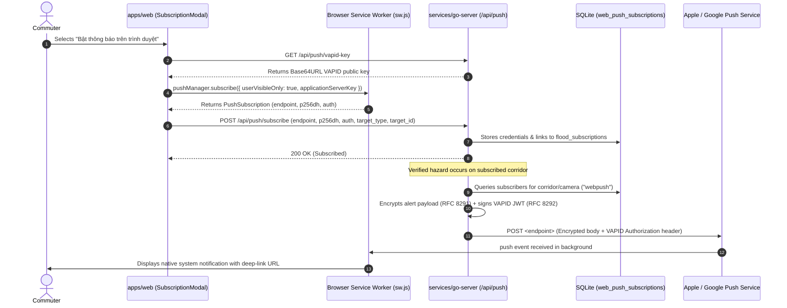

# S18-T2 Architectural Specification: Web Push API Subscription & VAPID Dispatcher

**Document:** `docs/superpowers/specs/2026-11-23-web-push-vapid-spec.md`  
**Issue:** [Issue #525: feat(push): Web Push API subscription manager and service worker notifications (VAPID)](https://github.com/529-studio/projectKV/issues/525)  
**Date:** 2026-11-23  
**Status:** DRAFT (Pending Review)  

---

## 1. Problem Statement & Commuter Rationale

Warded currently provides real-time flood alert delivery through the Telegram Bot (`warded_bot` / `services/go-server/internal/notify/telegram.go`). While Telegram offers reliable delivery for mobile messaging users, commuters who do not use Telegram require browser-native alerts.

When sudden convective cloudbursts or tidal peaks flood an arterial corridor (e.g. Võ Văn Kiệt or Nguyễn Hữu Cảnh), commuters with an active Web Push subscription must receive a system notification on desktop or mobile PWA—even when the Warded browser tab is closed—allowing a 1-tap jump to the live route map or camera feed.

---

## 2. Global Constraints & Principles

1. **Pure Go Standard Library Crypto (Ponytail Principle & Rule 7)**:
   - Zero third-party webpush dependencies in `services/go-server/go.mod`.
   - Implement RFC 8291 (ECE payload encryption with AES-128-GCM and ECDH) and RFC 8292 (VAPID JWT header signed with ES256) strictly via Go standard library packages (`crypto/ecdh`, `crypto/ecdsa`, `crypto/aes`, `crypto/cipher`, `crypto/sha256`).
2. **Monochromatic & Zero-Emoji UX (Rule 1)**:
   - Notification titles and body text must contain strictly zero emojis and maintain bilingual parity (`vi` default with full diacritics, `en` secondary).
3. **Zero Hardcoded Secrets (Rule 8)**:
   - Server VAPID keys loaded from `.env` (`VAPID_PUBLIC_KEY`, `VAPID_PRIVATE_KEY`, `VAPID_SUBJECT`) or auto-generated at startup in development if missing.
4. **Clean Modulith Leaf Boundaries (Rule 7)**:
   - `services/go-server/internal/push` is a leaf package implementing `notify.Channel` (`Name() == "webpush"`).
   - Hand-written SQL migrations on SQLite, zero ORM.
5. **Kiosk Touch Ergonomics**:
   - Subscription toggle buttons in the web client enforce $\ge 48\text{px} \times 48\text{px}$ touch hitboxes.

---

## 3. Architecture & System Flow



---

## 4. Technical Specifications & Interfaces

### 4.1 Database Migration (`0014_web_push_subscriptions.sql`)

```sql
-- Migration: 0014_web_push_subscriptions.sql
-- Stores W3C Web Push API credentials for browser clients (RFC 8291 / RFC 8292).

CREATE TABLE IF NOT EXISTS web_push_subscriptions (
    id            TEXT PRIMARY KEY,           -- SHA-256 hash of endpoint
    endpoint      TEXT NOT NULL UNIQUE,       -- Push service URL
    p256dh        TEXT NOT NULL,              -- Client P-256 public key (base64url)
    auth          TEXT NOT NULL,              -- 16-byte authentication secret (base64url)
    created_at    TIMESTAMP NOT NULL DEFAULT CURRENT_TIMESTAMP,
    updated_at    TIMESTAMP NOT NULL DEFAULT CURRENT_TIMESTAMP
);

CREATE INDEX IF NOT EXISTS idx_web_push_endpoint ON web_push_subscriptions(endpoint);
```

In `flood_subscriptions` (existing schema):
- `channel_name = 'webpush'`
- `chat_id = <web_push_subscriptions.id>`
- `target_type = 'all' | 'corridor' | 'zone' | 'ward' | 'chokepoint'`
- `target_id = <target_identifier>`

### 4.2 Backend REST Endpoints (`services/go-server/internal/push/handler.go`)

1. `GET /api/push/vapid-key`
   - Response: `{"public_key": "BEl62iUYgUivxIkv69yViEuiBIa-Ib9-SkvMeAtA3LFg..."}`
2. `POST /api/push/subscribe`
   - Request Body:
     ```json
     {
       "endpoint": "https://fcm.googleapis.com/fcm/send/...",
       "keys": {
         "p256dh": "BNcRdreALRF...",
         "auth": "tBHItJI5svb..."
       },
       "target_type": "corridor",
       "target_id": "vo_van_kiet"
     }
     ```
   - Response: `200 OK`
3. `POST /api/push/unsubscribe`
   - Request Body: `{"endpoint": "https://fcm.googleapis.com/fcm/send/..."}`
   - Response: `200 OK`
4. `POST /api/push/test` (Local/Testing verification endpoint):
   - Dispatches an immediate test push to the provided endpoint.

### 4.3 Backend VAPID & ECE Engine (`services/go-server/internal/push/client.go`)

- **VAPID Authorization Header** (RFC 8292):
  - Claims: `aud = <endpoint_origin>`, `sub = <mailto_or_url>`, `exp = now + 12h`.
  - Signed with NIST P-256 private key using ECDSA SHA-256 (`ES256`).
  - Header: `Authorization: vapid t=<jwt>, k=<base64url_public_key>`.
- **ECE Payload Encryption** (RFC 8291):
  - Derives shared secret using client `p256dh` and ephemeral server private key via `crypto/ecdh`.
  - Computes `PRK_key` and `PRK_nonce` via HKDF with client `auth` secret.
  - Encrypts payload with `AES-128-GCM` with 16-byte authentication tag.
  - Formats content-encoding: `aes128gcm` with standard 86-byte header containing record size, salt, and server public key.

### 4.4 Pruning Expired Subscriptions (HTTP 404 / 410 Gone)

When a push service (FCM, Apple, Mozilla) responds with `404 Not Found` or `410 Gone` (user revoked permission or uninstalled browser):
- The dispatcher automatically deletes the corresponding row from `web_push_subscriptions` and `flood_subscriptions`, preventing dead dispatch loops.

### 4.5 Frontend Service Worker (`apps/web/public/sw.js`)

```javascript
self.addEventListener('push', function (event) {
  if (!event.data) return;
  const payload = event.data.json();
  const options = {
    body: payload.body,
    icon: '/icon.png',
    badge: '/icon.png',
    data: {
      url: payload.url || '/',
      road_key: payload.road_key,
      severity: payload.severity,
    },
    vibrate: [200, 100, 200],
    tag: payload.tag || 'warded-flood-alert',
    renotify: true,
  };
  event.waitUntil(self.registration.showNotification(payload.title, options));
});

self.addEventListener('notificationclick', function (event) {
  event.notification.close();
  const targetUrl = event.notification.data?.url || '/';
  event.waitUntil(
    clients.matchAll({ type: 'window', includeUncontrolled: true }).then(function (clientList) {
      for (const client of clientList) {
        if (client.url === targetUrl && 'focus' in client) {
          return client.focus();
        }
      }
      if (clients.openWindow) {
        return clients.openWindow(targetUrl);
      }
    })
  );
});
```

### 4.6 Frontend Web Push Hook (`apps/web/src/hooks/useWebPush.ts`)

- Detects push support: `'serviceWorker' in navigator && 'PushManager' in window && 'Notification' in window`.
- Reads permission state (`default`, `granted`, `denied`).
- Provides `subscribeToPush(targetType, targetId)` and `unsubscribeFromPush()`.
- Converts VAPID Base64URL string to `Uint8Array` for `pushManager.subscribe`.

### 4.7 Frontend Subscription Modal Integration (`apps/web/src/components/SubscriptionModal.tsx`)

- Adds a dual-tab toggle:
  1. **Telegram Bot** (Existing instant deep-link).
  2. **Trình duyệt / Web Push** (One-tap browser permission opt-in).
- Explains zero-tracking policy: subscriptions only store the browser endpoint and public key, zero GPS coordinates or user identities.

---

## 5. Verification Strategy & Acceptance Criteria

1. **Unit Tests (Go Backend)**:
   - `services/go-server/internal/push/client_test.go`:
     - Test VAPID JWT token generation and signature verification with standard `crypto/ecdsa`.
     - Test RFC 8291 payload encryption and round-trip decryption using known RFC test vectors.
     - Test 404/410 auto-pruning with an HTTP test server.
   - `services/go-server/internal/push/store_test.go`:
     - Test database insertion, idempotency, foreign key lookup, and deletion.
2. **Unit Tests (Web Frontend)**:
   - `apps/web/src/hooks/useWebPush.test.ts`:
     - Test VAPID base64URL conversion, permission states, and API payload contracts.
   - `apps/web/src/components/SubscriptionModal.test.ts`:
     - Test tab switching, button touch target $\ge 48\text{px}$, and zero-emoji compliance.
3. **End-to-End Simulation**:
   - Send mock flood alert and corridor hazard alert through `notify.Manager` with `"webpush"` channel registered.
   - Verify push HTTP request contains valid `Authorization: vapid ...` and `Content-Encoding: aes128gcm`.
4. **CI & Lint Gates**:
   - `python3 tools/docs/docs_lint.py` passes with 0 new violations.
   - `make test-go` passes with `-race`.
   - `cd apps/web && npm test` passes 100%.
